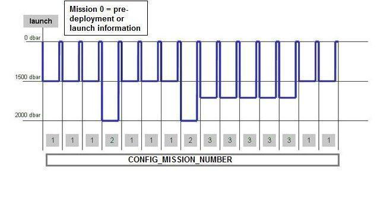

# Metadata format version 3.2 
The format version 3.2 of Argo metadata will replace version 3.1 gradually. During the transition period, all formats will be valid.

An Argo metadata file contains descriptive information about an Argo float.

For file naming conventions, see [<u>§4.1</u>](#data-access).

All variables are mandatory when not otherwise stated in the comment column of the tables.

## Global attributes
The global attributes section is used for data discovery. It complies with NetCDF Climate and Forecast (CF) Metadata Conventions (version 1.6).

- [<u>http://cfconventions.org/</u>](http://cfconventions.org/)

The following global attributes should appear in the global section (attributes in italic are optional attributes):

// global attributes:

:title = "Argo float metadata file";

:institution = "CSIRO";

:source = "Argo float";

:history = "2011-04-22T06:00:00Z creation";

:references = "[<u>http://www.argodatamgt.org/Documentation</u>](http://www.argodatamgt.org/Documentation)";

*:id = "[<u>https://doi.org/10.17882/42182</u>](https://doi.org/10.17882/42182)"*

:comment = "free text";

:user_manual_version = "3.45";

:Conventions = "Argo-3.2 CF-1.6";

<table>
<colgroup>
<col style="width: 21%" />
<col style="width: 78%" />
</colgroup>
<tbody>
<tr class="odd">
<td><strong>Global attribute name</strong></td>
<td><strong>Definition</strong></td>
</tr>
<tr class="even">
<td>title</td>
<td>A succinct description of what is in the dataset.</td>
</tr>
<tr class="odd">
<td>institution</td>
<td>Specifies where the original data was produced.</td>
</tr>
<tr class="even">
<td>source</td>
<td>The method of production of the original data. If it was model-generated, source should name the model and its version, as specifically as could be useful. If it is observational, source should characterize it (e.g., "surface observation" or "radiosonde").</td>
</tr>
<tr class="odd">
<td>history</td>
<td>Provides an audit trail for modifications to the original data. Well-behaved generic NetCDF filters will automatically append their name and the parameters with which they were invoked to the global history attribute of an input NetCDF file. We recommend that each line begins with a timestamp indicating the date and time of day that the program was executed.</td>
</tr>
<tr class="even">
<td>references</td>
<td>Published or web-based references that describe the data or methods used to produce it.</td>
</tr>
<tr class="odd">
<td>id</td>
<td>
The Argo GDAC data DOI: <a href="https://doi.org/10.17882/42182"><u>https://doi.org/10.17882/42182</u></a>

This attribute is <strong>optional</strong> but highly recommended
</td>
</tr>
<tr class="even">
<td>comment</td>
<td>Miscellaneous information about the data or methods used to produce it.</td>
</tr>
<tr class="odd">
<td>user_manual_version</td>
<td>The version number of the user manual</td>
</tr>
<tr class="even">
<td>Conventions</td>
<td>The conventions supported by this file, blank separated</td>
</tr>
</tbody>
</table>

## Dimensions and definitions 
<table>
<colgroup>
<col style="width: 24%" />
<col style="width: 28%" />
<col style="width: 47%" />
</colgroup>
<tbody>
<tr class="odd">
<td><strong>Name</strong></td>
<td><strong>Definition</strong></td>
<td><strong>Comment</strong></td>
</tr>
<tr class="even">
<td>DATE_TIME</td>
<td>DATE_TIME = 14;</td>
<td>
This dimension is the length of an ASCII date and time value.

Date_time convention is : YYYYMMDDHHMISS

YYYY : year

MM : month

DD : day

HH : hour of the day

MI : minutes

SS : seconds

Date and time values are always in universal time coordinates (UTC).

Examples : 20010105172834 : January 5th 2001 17:28:34 19971217000000 : December 17th 1997 00:00:00
</td>
</tr>
<tr class="odd">
<td>
STRING8192

STRING4096

STRING1024

STRING256

STRING128

STRING64

STRING32

STRING17

STRING16

STRING8

STRING4

STRING2
</td>
<td>
STRING8192 = 8192;

STRING4096 = 4096;

STRING1024 = 1024;

STRING256 = 256;

STRING128 = 128;

STRING64 = 64;

STRING32 = 32;

STRING17 = 17;

STRING16 = 16;

STRING8 = 8;

STRING4 = 4;

STRING2 = 2;
</td>
<td>
String dimensions from 2 to 8192.

STRING4096 and STRING8192 are optional (see <a href="#float-predeployment-calibration-information"><u>§2.4.8</u></a>)
</td>
</tr>
<tr class="even">
<td>N_PARAM</td>
<td>N_PARAM = &lt;int value&gt;;</td>
<td>
Number of parameters measured or calculated for a pressure sample.

Examples :

(pressure, temperature) : N_PARAM = 2

(pressure, temperature, salinity) : N_PARAM = 3 (pressure, temperature, conductivity, salinity) : N_PARAM = 4
</td>
</tr>
<tr class="odd">
<td>N_SENSOR</td>
<td>N_SENSOR = &lt;int value&gt;;</td>
<td>Number of sensors mounted on the float and used to measure the parameters.</td>
</tr>
<tr class="even">
<td>N_CONFIG_PARAM</td>
<td>N_CONFIG_PARAM=&lt;int value&gt;;</td>
<td>Number of configuration parameters.</td>
</tr>
<tr class="odd">
<td>N_LAUNCH_CONFIG_PARAM</td>
<td>N_LAUNCH_CONFIG_PARAM=&lt;int value&gt;;</td>
<td>Number of pre-deployment or launch configuration parameters.</td>
</tr>
<tr class="even">
<td>N_MISSIONS</td>
<td>N_MISSIONS=&lt;unlimited&gt;;</td>
<td>Number of missions.</td>
</tr>
<tr class="odd">
<td>N_POSITIONING_SYSTEM</td>
<td>N_POSITIONING_SYSTEM=&lt;int value&gt;;</td>
<td>Number of positioning systems.</td>
</tr>
<tr class="even">
<td>N_TRANS_SYSTEM</td>
<td>N_TRANS_SYSTEM=&lt;int value&gt;;</td>
<td>Number of transmission systems.</td>
</tr>
</tbody>
</table>

## General information on the metadata file 
This section contains information about the whole file.

<table>
<colgroup>
<col style="width: 19%" />
<col style="width: 46%" />
<col style="width: 33%" />
</colgroup>
<tbody>
<tr class="odd">
<td><strong>Name</strong></td>
<td><strong>Definition</strong></td>
<td><strong>Comment</strong></td>
</tr>
<tr class="even">
<td>DATA_TYPE</td>
<td>
char DATA_TYPE(STRING16);

DATA_TYPE:long_name = "Data type";

DATA_TYPE:conventions = "Argo reference table 1";

DATA_TYPE:_FillValue = " ";
</td>
<td>
This field contains the type of data contained in the file.

The list of acceptable data types is in the reference table 1 (<a href="https://vocab.nerc.ac.uk/collection/R01/"><u>https://vocab.nerc.ac.uk/collection/R01/</u></a>).

For the metadata file, the value must be set to "Argo meta-data"
</td>
</tr>
<tr class="odd">
<td>FORMAT_VERSION</td>
<td>
char FORMAT_VERSION(STRING4);

FORMAT_VERSION:long_name = "File format version";

FORMAT_VERSION:_FillValue = " ";
</td>
<td>
File format version.

Example: "3.2"
</td>
</tr>
<tr class="even">
<td><del>HANDBOOK_VERSION</del></td>
<td>
<del>char HANDBOOK_VERSION(STRING4);</del>

<del>HANDBOOK_VERSION:long_name = "Data handbook version";</del>

<del>HANDBOOK_VERSION:_FillValue = " ";</del>
</td>
<td>
REMOVED in meta FORMAT_VERSION 3.2: <del>Version number of the data handbook. This field indicates that the data contained in this file are managed according to the policy described in the Argo data management handbook.</del>

<del>Example: "1.0"</del>
</td>
</tr>
<tr class="odd">
<td>DATE_CREATION</td>
<td>
char DATE_CREATION(DATE_TIME);

DATE_CREATION:long_name = "Date of file creation";

DATE_CREATION:conventions = "YYYYMMDDHHMISS";

DATE_CREATION:_FillValue = " ";
</td>
<td>
Date and time (UTC) of creation of this file.

Example: "20011229161700" (meaning December 29th 2001 16:17:00)
</td>
</tr>
<tr class="even">
<td>DATE_UPDATE</td>
<td>
char DATE_UPDATE(DATE_TIME);

DATE_UPDATE:long_name = "Date of update of this file";

DATE_UPDATE:conventions = "YYYYMMDDHHMISS";

DATE_UPDATE:_FillValue = " ";
</td>
<td>
Date and time (UTC) of update of this file.

Example: "20011230090500" (meaning December 30th 2001 09:05:00)
</td>
</tr>
</tbody>
</table>

## Float characteristics 
This section contains the main characteristics of the float.

<table>
<colgroup>
<col style="width: 28%" />
<col style="width: 40%" />
<col style="width: 31%" />
</colgroup>
<tbody>
<tr class="odd">
<td><strong>Name</strong></td>
<td><strong>Definition</strong></td>
<td><strong>Comment</strong></td>
</tr>
<tr class="even">
<td>PLATFORM_NUMBER</td>
<td>
char PLATFORM_NUMBER(STRING8);

PLATFORM_NUMBER:long_name = "Float unique identifier";

PLATFORM_NUMBER:conventions = "WMO float identifier : A9IIIII";

PLATFORM_NUMBER:_FillValue = " ";
</td>
<td>
WMO float identifier. WMO is the World Meteorological Organization. This platform number is unique.

Example: 6900045
</td>
</tr>
<tr class="odd">
<td>PLATFORM_WIGOS_ID</td>
<td>
char PLATFORM_WIGOS_ID(STRING17);

PLATFORM_WIGOS_ID:long_name = "Float unique identifier";

PLATFORM_WIGOS_ID:conventions = "WMO WIGOS float identifier: 0-22000-0-A9IIIII";

PLATFORM_WIGOS_ID:_FillValue = " ";
</td>
<td>
<strong><del>This is an optional variable.</del></strong>

WMO WIGOS float identifier. WMO is the World Meteorological Organization.

This platform number is unique within all observation platforms. For Argo floats, it is composed of "0-22000-0-", the Argo float prefix, followed by the WMO ID.

For example, for float 6900045:

PLATFORM_WIGOS_ID = "0-22000-0-6900045"
</td>
</tr>
<tr class="even">
<td>PTT</td>
<td>
char PTT(STRING256);

PTT:long_name = "Transmission identifier (ARGOS, ORBCOMM, etc.)";

PTT:_FillValue = " ";
</td>
<td>
Transmission identifier of the float. Comma separated list for multi-beacon transmission.

Examples:

"22507" (example when the float is equipped with one ARGOS beacon)

"22598, 22768" (example when the float is equipped with 2 ARGOS beacons)
</td>
</tr>
<tr class="odd">
<td>TRANS_SYSTEM</td>
<td>
char TRANS_SYSTEM(N_TRANS_SYSTEM, STRING16);

TRANS_SYSTEM:long_name = "Telecommunication system used";

TRANS_SYSTEM:_FillValue = " ";
</td>
<td>
Name of the telecommunication system from reference table 10 (<a href="https://vocab.nerc.ac.uk/collection/R10/"><u>https://vocab.nerc.ac.uk/collection/R10/</u></a>).

Example: "ARGOS"
</td>
</tr>
<tr class="even">
<td>TRANS_SYSTEM_ID</td>
<td>
char TRANS_SYSTEM_ID(N_TRANS_SYSTEM, STRING32);

TRANS_SYSTEM_ID:long_name = "Program identifier used by the transmission system";

TRANS_SYSTEM_ID:_FillValue = " ";
</td>
<td>
Program identifier of the telecommunication subscription. DACs can use N/A or alternative of their choice when not applicable (e.g. : Iridium or Orbcomm)

Example: 38511 is a program number for all the beacons of an ARGOS customer.
</td>
</tr>
<tr class="odd">
<td>TRANS_FREQUENCY</td>
<td>
char TRANS_FREQUENCY(N_TRANS_SYSTEM, STRING16);

TRANS_FREQUENCY:long_name = "Frequency of transmission from the float";

TRANS_FREQUENCY:units = "hertz";

TRANS_FREQUENCY:_FillValue = " ";
</td>
<td>
Frequency of transmission from the float.

Example: "1/44"
</td>
</tr>
<tr class="even">
<td>POSITIONING_SYSTEM</td>
<td>
char POSITIONING_SYSTEM(N_POSITIONING_SYSTEM, STRING8);

POSITIONING_SYSTEM:long_name = "Positioning system";

POSITIONING_SYSTEM:_FillValue = " ";
</td>
<td>
Position system from reference table 9 (<a href="https://vocab.nerc.ac.uk/collection/R09/"><u>https://vocab.nerc.ac.uk/collection/R09/</u></a>). ARGOS or GPS are 2 positioning systems.

Example: "ARGOS"
</td>
</tr>
<tr class="odd">
<td>PLATFORM_FAMILY</td>
<td>
char PLATFORM_FAMILY(STRING256);

PLATFORM_FAMILY:long_name = "Category of instrument";

PLATFORM_FAMILY:conventions = "Argo reference table 22";

PLATFORM_FAMILY:_FillValue = " ";
</td>
<td>
Category of instrument.

See Argo reference table 22 (<a href="https://vocab.nerc.ac.uk/collection/R22/"><u>https://vocab.nerc.ac.uk/collection/R22/</u></a>).

Example: "FLOAT"
</td>
</tr>
<tr class="even">
<td>PLATFORM_TYPE</td>
<td>
char PLATFORM_TYPE(STRING32);

PLATFORM_TYPE:long_name = "Type of float";

PLATFORM_TYPE:conventions = "Argo reference table 23";

PLATFORM_TYPE:_FillValue = " ";
</td>
<td>
Type of float.

See Argo reference table 23 (<a href="https://vocab.nerc.ac.uk/collection/R23/"><u>https://vocab.nerc.ac.uk/collection/R23/</u></a>).

Example: "APEX"
</td>
</tr>
<tr class="odd">
<td>PLATFORM_MAKER</td>
<td>
char PLATFORM_MAKER(STRING256);

PLATFORM_MAKER:long_name = "Name of the manufacturer";

PLATFORM_MAKER:conventions = "Argo reference table 24";

PLATFORM_MAKER:_FillValue = " ";
</td>
<td>
Name of the manufacturer.

See Argo reference table 24 (<a href="https://vocab.nerc.ac.uk/collection/R24/"><u>https://vocab.nerc.ac.uk/collection/R24/</u></a>).

Example: "TWR"
</td>
</tr>
<tr class="even">
<td>FLOAT_FIRMWARE_VERSION</td>
<td>
char FLOAT_FIRMWARE_VERSION(STRING64);

FLOAT_FIRMWARE_VERSION:long_name = "Firmware version for the float";

FLOAT_FIRMWARE_VERSION:_FillValue = " ";
</td>
<td>
The float firmware version. This is specified as per the format on the manufacturer’s manual.

char FLOAT_FIRMWARE_VERSION(<strong>STRING32</strong>) is also accepted.

Example: "072804"
</td>
</tr>
<tr class="odd">
<td>FLOAT_MANUAL_VERSION</td>
<td>
char FLOAT_MANUAL_VERSION(STRING16);

FLOAT_MANUAL_VERSION:long_name = "Manual version for the float";

FLOAT_MANUAL_VERSION:_FillValue = " ";
</td>
<td>
The version date or number for the manual for each float.

char FLOAT_MANUAL_VERSION(<strong>STRING128</strong>) is also accepted.

Example: "110610", "004"
</td>
</tr>
<tr class="even">
<td>FLOAT_SERIAL_NO</td>
<td>
char FLOAT_SERIAL_NO(STRING32);

FLOAT_SERIAL_NO:long_name = "Serial number of the float";

FLOAT_SERIAL_NO:_FillValue = " ";
</td>
<td>
This field should contain only the serial number of the float.

Example: "1679"
</td>
</tr>
<tr class="odd">
<td>STANDARD_FORMAT_ID</td>
<td>
char STANDARD_FORMAT_ID(STRING16);

STANDARD_FORMAT_ID:long_name = "Standard format number to describe the data format type for each float";

STANDARD_FORMAT_ID:_FillValue = " ";
</td>
<td>
Standardized format number as described in the online reference table: <a href="https://docs.google.com/spreadsheets/d/16iTji2i9tLh2PfiiMItfhaQybQB1NLAhj4s0mDML5yY/edit#gid=9"><u>https://docs.google.com/spreadsheets/d/16iTji2i9tLh2PfiiMItfhaQybQB1NLAhj4s0mDML5yY/edit#gid=9</u></a>

This table cross references to individual DAC format numbers.

Example: "1010151"
</td>
</tr>
<tr class="even">
<td>DAC_FORMAT_ID</td>
<td>
char DAC_FORMAT_ID(STRING16);

DAC_FORMAT_ID:long_name = "Format number used by the DAC to describe the data format type for each float";

DAC_FORMAT_ID:_FillValue = " ";
</td>
<td>
Format numbers used by individual DACs to describe each float type.

This is cross-referenced to a standard format id as outlined in the online reference table: <a href="https://docs.google.com/spreadsheets/d/16iTji2i9tLh2PfiiMItfhaQybQB1NLAhj4s0mDML5yY/edit#gid=9"><u>https://docs.google.com/spreadsheets/d/16iTji2i9tLh2PfiiMItfhaQybQB1NLAhj4s0mDML5yY/edit#gid=9</u></a>

Example: "A9"
</td>
</tr>
<tr class="odd">
<td>WMO_INST_TYPE</td>
<td>
char WMO_INST_TYPE(STRING4);

WMO_INST_TYPE:long_name = "Coded instrument type";

WMO_INST_TYPE:conventions = "Argo reference table 8";

WMO_INST_TYPE:_FillValue = " ";
</td>
<td>
Instrument type from WMO code table 1770. A subset of WMO table 1770 is documented in the reference table 8 (<a href="https://vocab.nerc.ac.uk/collection/R08/"><u>https://vocab.nerc.ac.uk/collection/R08/</u></a>).

Example: "846" (corresponding to Webb Research float, Seabird sensor)
</td>
</tr>
<tr class="even">
<td>PROJECT_NAME</td>
<td>
char PROJECT_NAME(STRING64);

PROJECT_NAME:long_name = "Name of the project";

PROJECT_NAME:_FillValue = " ";
</td>
<td>Name of the project that operates the float. Multiple projects are separated by commas. 
Example: "GYROSCOPE, GMMC"</td>
</tr>
<tr class="odd">
<td>PROGRAM_NAME</td>
<td>
char PROGRAM_NAME(STRING64);

PROGRAM_NAME:long_name = "Name of the program";

PROGRAM_NAME:_FillValue = " ";
</td>
<td>
This variable becomes mandatory in meta version 3.2.

The overarching program(s) of which the float is a part. A program consists of a set of related and possibly interdependent projects (PROJECT_NAME) that meet an overarching objective. A program defines a group of floats managed by the same lead agency. It materializes the implementing, operating, and responsible team.

The PROGRAM_NAME list is managed by OceanOPS. Detailed definition of PROGRAM_NAME is available here: <a href="https://www.ocean-ops.org/metadata/#concept-definitions"><u>https://www.ocean-ops.org/metadata/#concept-definitions</u></a>.

See Argo reference table 41 (<a href="https://vocab.nerc.ac.uk/collection/R41/"><u>https://vocab.nerc.ac.uk/collection/R41/</u></a>).

Examples: "Argo INDIA" or "Argo UK Bio" or "Argo UW"
</td>
</tr>
<tr class="even">
<td>DATA_CENTRE</td>
<td>
char DATA_CENTRE(STRING2);

DATA_CENTRE:long_name = "Data centre in charge of float real-time processing";

DATA_CENTRE:conventions = "Argo reference table 4";

DATA_CENTRE:_FillValue = " ";
</td>
<td>
Code of the data centre in charge of the float data management. The data centre codes are described in the reference table 4 (<a href="https://vocab.nerc.ac.uk/collection/R04/"><u>https://vocab.nerc.ac.uk/collection/R04/</u></a>).

Example: "ME" (for MEDS)
</td>
</tr>
<tr class="odd">
<td>PI_NAME</td>
<td>
char PI_NAME (STRING64);

PI_NAME:long_name = "Name of the principal investigator";

PI_NAME:_FillValue = " ";
</td>
<td>
Name of the principal investigator responsible for the profiling float. Valid PI names are listed in reference table 40 (<a href="https://vocab.nerc.ac.uk/collection/R40/"><u>https://vocab.nerc.ac.uk/collection/R40/</u></a>). The generic convention to follow is "Firstname1 [Firstname2] LASTNAME". Multiple names can be concatenated, separated by commas.

Example: "Julia UITZ, Birgit KLEIN"
</td>
</tr>
<tr class="even">
<td>ANOMALY</td>
<td>
char ANOMALY(STRING256);

ANOMALY:long_name = "Describe any anomalies or problems the float may have had";

ANOMALY:_FillValue = " ";
</td>
<td>
This field describes any anomaly or problem the float may have had.

This field is also used to record ending causes (see <a href="#reference-table-31-ending_cause"><u>§3.29</u></a>).

Example: "the immersion drift is not stable."
</td>
</tr>
<tr class="odd">
<td>BATTERY_TYPE</td>
<td>
char BATTERY_TYPE(STRING64);

BATTERY_TYPE:long_name = "Type of battery packs in the float";

BATTERY_TYPE:_FillValue = " ";
</td>
<td>
Describes the type of battery packs in the float.

BATTERY_TYPE syntax uses both reference table 33 altLabel (<a href="https://vocab.nerc.ac.uk/collection/R33/"><u>https://vocab.nerc.ac.uk/collection/R33/</u></a>) and reference table 34 altLabel (<a href="https://vocab.nerc.ac.uk/collection/R34/"><u>https://vocab.nerc.ac.uk/collection/R34/</u></a>) with the following convention: &lt;R33-battery_maker&gt; &lt;R34-battery_type&gt; &lt;voltage&gt; V [+&lt;R33-battery_maker&gt; &lt;R34-battery_type&gt; &lt;voltage&gt; V].

&lt;voltage&gt; stands for the initial battery voltage.

Examples:

"<em>ELECTROCHEM Lithium 15.0 V</em>"

"<em>TADIRAN Lithium 15 V</em> + <em>TADIRAN Lithium 12.1 V"</em>
</td>
</tr>
<tr class="even">
<td>BATTERY_PACKS</td>
<td>
char BATTERY_PACKS(STRING64);

BATTERY_PACKS:long_name = "Configuration of battery packs in the float";

BATTERY_PACKS:_FillValue = " ";
</td>
<td>
Describes the configuration of battery packs in the float, number and type.

BATTERY_PACKS uses both reference table 35 altLabel (<a href="https://vocab.nerc.ac.uk/collection/R35"><u>https://vocab.nerc.ac.uk/collection/R35</u></a>) and reference table 34 prefLabel (<a href="https://vocab.nerc.ac.uk/collection/R34/"><u>https://vocab.nerc.ac.uk/collection/R34/</u></a>) with the following convention: &lt;x&gt;&lt;R35-battery_size&gt; &lt;R34-battery_type&gt; [+&lt;x&gt;&lt;R35-battery_size&gt; &lt;R34-battery_type&gt;].

&lt;x&gt; indicates the number of packs (not the number of batteries in a pack).

"U" standing for "unknown" is also accepted.

Example: "4DD Li + 1C Alk"
</td>
</tr>
<tr class="odd">
<td>CONTROLLER_BOARD_TYPE_PRIMARY</td>
<td>
char CONTROLLER_BOARD_TYPE_PRIMARY(STRING32);

CONTROLLER_BOARD_TYPE_PRIMARY:long_name = "Type of primary controller board";

CONTROLLER_BOARD_TYPE_PRIMARY:_FillValue = " ";
</td>
<td>
Describes the type of controller board. See reference table 28 (<a href="https://vocab.nerc.ac.uk/collection/R28/"><u>https://vocab.nerc.ac.uk/collection/R28/</u></a>) for the left part of the variable. An optional free text within square brackets can be appended to detail the firmware version of the controller board.

Example: "APF9 [iridium version xyz]"
</td>
</tr>
<tr class="even">
<td>CONTROLLER_BOARD_TYPE_SECONDARY</td>
<td>
char CONTROLLER_BOARD_TYPE_SECONDARY(STRING32);

CONTROLLER_BOARD_TYPE_SECONDARY:long_name = "Type of secondary controller board";

CONTROLLER_BOARD_TYPE_SECONDARY:_FillValue = " ";
</td>
<td>
<strong>This is an optional variable.</strong>

Only applicable if there is more than one controller board in the float. Describes the second type of controller board. See reference table 28 (<a href="https://vocab.nerc.ac.uk/collection/R28/"><u>https://vocab.nerc.ac.uk/collection/R28/</u></a>) for the left part of the variable. An optional free text within square brackets can be appended to detail the firmware version of the controller board.

Example: "APF9 [iridium version xyz]"
</td>
</tr>
<tr class="odd">
<td>CONTROLLER_BOARD_SERIAL_NO_PRIMARY</td>
<td>
char CONTROLLER_BOARD_SERIAL_NO_PRIMARY(STRING32);

CONTROLLER_BOARD_SERIAL_NO_PRIMARY:long_name = "Serial number of the primary controller board";

CONTROLLER_BOARD_SERIAL_NO_PRIMARY:_FillValue = " ";
</td>
<td>
The serial number for the primary controller board.

Example: "4567"
</td>
</tr>
<tr class="even">
<td>CONTROLLER_BOARD_SERIAL_NO_SECONDARY</td>
<td>
char CONTROLLER_BOARD_SERIAL_NO_SECONDARY(STRING32);

CONTROLLER_BOARD_SERIAL_NO_SECONDARY:long_name = "Serial number of the secondary controller board";

CONTROLLER_BOARD_SERIAL_NO_SECONDARY:_FillValue = " ";
</td>
<td>
<strong>This is an optional variable.</strong>

Only applicable if there is more than one controller board in the float. The serial number for the secondary controller board.

Example: "4571"
</td>
</tr>
<tr class="odd">
<td>SPECIAL_FEATURES</td>
<td>
char SPECIAL_FEATURES(STRING1024);

SPECIAL_FEATURES:long_name = "Extra features of the float (algorithms, compressee etc.)";

SPECIAL_FEATURES:_FillValue = " ";
</td>
<td>
Additional float features can be specified within this variable. These features can be (e.g.):

<ul>
<li>
specific algorithms (such as ISA)
</li>
<li>
Specific materials
</li>
<li>
Specific sensor/parameter, for which data is in the auxiliary repository.
</li>
</ul>

N.B.: when there are AUX data files, the SPECIAL_FEATURE variable must be filled by the DAC. In this case, the string <strong>must</strong> include the substring ‘<strong>AUX</strong>’ for machine parsing (more details in <a href="https://argo.ucsd.edu/data/auxiliary-directory"><u>https://argo.ucsd.edu/data/auxiliary-directory</u></a>).

Examples:

Algorithms: <em>"Ice Sensing Algorithm", "Interim Storage Algorithm", "grounding avoidance"</em>

Materials: "<em>compressee</em>" (buoyancy compensator), "<em>ARVOR DEEP 2 HEAD WITH ADDITIONAL RBR SN 205111 CTD PROBE</em>".

Specific sensor/parameters: " <em>THIS FLOAT HAS AUXILIARY SENSORS FOR HYPERSPECTRAL RADIOMETRIC MEASUREMENT", "AUXILIARY_SENSOR_FLOATRIDER"</em>
</td>
</tr>
<tr class="even">
<td>FLOAT_OWNER</td>
<td>
char FLOAT_OWNER (STRING64);

FLOAT_OWNER:long_name = "Float owner";

FLOAT_OWNER:_FillValue = " ";
</td>
<td>
The owner of the float (may be different from the data centre and operating institution).

Example: "Joe Blogg"
</td>
</tr>
<tr class="odd">
<td>OPERATING_INSTITUTION</td>
<td>
char OPERATING_INSTITUTION(STRING64);

OPERATING_INSTITUTION:long_name = "Operating institution of the float";

OPERATING_INSTITUTION:_FillValue = " ";
</td>
<td>
The operating institution of the float (may be different from the float owner and data centre).

Example: "ACE CRC"
</td>
</tr>
<tr class="even">
<td>CUSTOMISATION</td>
<td>
char CUSTOMISATION(STRING1024);

CUSTOMISATION:long_name = "Float customisation, i.e. (institution and modifications)";

CUSTOMISATION:_FillValue = " ";
</td>
<td>
Free form field to record changes made to the float after manufacture and before deployment, i.e. this could be the customisation institution plus a list of modifications.

Example: "Float stability collar removed for deployment in ice."
</td>
</tr>
</tbody>
</table>

## Float deployment and mission information 
<table>
<colgroup>
<col style="width: 23%" />
<col style="width: 51%" />
<col style="width: 25%" />
</colgroup>
<tbody>
<tr class="odd">
<td><strong>Name</strong></td>
<td><strong>Definition</strong></td>
<td><strong>Comment</strong></td>
</tr>
<tr class="even">
<td>LAUNCH_DATE</td>
<td>
char LAUNCH_DATE(DATE_TIME);

LAUNCH_DATE:long_name = "Date (UTC) of the deployment";

LAUNCH_DATE:conventions = "YYYYMMDDHHMISS";

LAUNCH_DATE:_FillValue = " ";
</td>
<td>
Date and time (UTC) of launch of the float.

Format : YYYYMMDDHHMISS

Example: "20011230090500" (meaning December 30th 2001 03:05:00)
</td>
</tr>
<tr class="odd">
<td>LAUNCH_LATITUDE</td>
<td>
double LAUNCH_LATITUDE;

LAUNCH_LATITUDE:long_name = "Latitude of the float when deployed";

LAUNCH_LATITUDE:units = "degree_north";

LAUNCH_LATITUDE:_FillValue = 99999.;

LAUNCH_LATITUDE:valid_min = -90.;

LAUNCH_LATITUDE:valid_max = 90.;
</td>
<td>
Latitude of the launch as a real number between -90 and 90.

Unit : degree north

Example: 44.4991 (corresponding to 44° 29’ 56.76’’ N)
</td>
</tr>
<tr class="even">
<td>LAUNCH_LONGITUDE</td>
<td>
double LAUNCH_LONGITUDE;

LAUNCH_LONGITUDE:long_name = "Longitude of the float when deployed";

LAUNCH_LONGITUDE:units = "degree_east"; LAUNCH_LONGITUDE:_FillValue = 99999.;

LAUNCH_LONGITUDE:valid_min = -180.;

LAUNCH_LONGITUDE:valid_max = 180.;
</td>
<td>
Longitude of the launch as a real number between -180 and 180.

Unit : degree east.

Example: 16.7222 (corresponding to 16° 43’ 19.92’’ E)
</td>
</tr>
<tr class="odd">
<td>LAUNCH_QC</td>
<td>
char LAUNCH_QC;

LAUNCH_QC:long_name = "Quality on launch date, time and location";

LAUNCH_QC:conventions = "Argo reference table 2";

LAUNCH_QC:_FillValue = " ";
</td>
<td>
Quality flag on launch date, time and location.

The flag scale is described in the reference tables 2 (<a href="https://vocab.nerc.ac.uk/collection/RR2/"><u>https://vocab.nerc.ac.uk/collection/RR2/</u></a> for real time and <a href="https://vocab.nerc.ac.uk/collection/RD2/"><u>https://vocab.nerc.ac.uk/collection/RD2/</u></a> for delayed mode).

Example: "1" (meaning launch location seems correct)
</td>
</tr>
<tr class="even">
<td>START_DATE</td>
<td>
char START_DATE(DATE_TIME);

START_DATE:long_name = "Date (UTC) of the first

descent of the float";

START_DATE:conventions = "YYYYMMDDHHMISS"; START_DATE:_FillValue = " ";
</td>
<td>
Date and time (UTC) of the first descent of the float.

Format : YYYYMMDDHHMISS

Example: "20011230090500" (meaning December 30th 2001 06:05:00)
</td>
</tr>
<tr class="odd">
<td>START_DATE_QC</td>
<td>
char START_DATE_QC;

START_DATE_QC:long_name = "Quality on start date";

START_DATE_QC:conventions = "Argo reference table 2";

START_DATE_QC:_FillValue = " ";
</td>
<td>
Quality flag on start date. The flag scale is described in the reference tables 2 (<a href="https://vocab.nerc.ac.uk/collection/RR2/"><u>https://vocab.nerc.ac.uk/collection/RR2/</u></a> for real time and <a href="https://vocab.nerc.ac.uk/collection/RD2/"><u>https://vocab.nerc.ac.uk/collection/RD2/</u></a> for delayed mode).

Example: "1" (meaning start date seems correct)
</td>
</tr>
<tr class="even">
<td>STARTUP_DATE</td>
<td>
char STARTUP_DATE(DATE_TIME);

STARTUP_DATE:long_name = "Date (UTC) of the activation of the float";

STARTUP_DATE:conventions = "YYYYMMDDHHMISS"; STARTUP_DATE:_FillValue = " ";
</td>
<td>
Date and time (UTC) of the activation of the float before or just after deployment. This may include automatic startup during pressure activation.

Format : YYYYMMDDHHMISS

Example: "20011230090500" (meaning December 30th 2001 06:05:00)
</td>
</tr>
<tr class="odd">
<td>STARTUP_DATE_QC</td>
<td>
char STARTUP_DATE_QC;

STARTUP_DATE_QC:long_name = "Quality on startup date";

STARTUP_DATE_QC:conventions = "Argo reference table 2";

STARTUP_DATE_QC:_FillValue = " ";
</td>
<td>
Quality flag on startup date. The flag scale is described in the reference tables 2 (<a href="https://vocab.nerc.ac.uk/collection/RR2/"><u>https://vocab.nerc.ac.uk/collection/RR2/</u></a> for real time and <a href="https://vocab.nerc.ac.uk/collection/RD2/"><u>https://vocab.nerc.ac.uk/collection/RD2/</u></a> for delayed mode).

Example: "1" (meaning startup date seems correct)
</td>
</tr>
<tr class="even">
<td>DEPLOYMENT_PLATFORM</td>
<td>
char DEPLOYMENT_PLATFORM(STRING128);

DEPLOYMENT_PLATFORM:long_name = "Identifier of the deployment platform";

DEPLOYMENT_PLATFORM:_FillValue = " ";
</td>
<td>
Identifier of the deployment platform, i.e. vessel or ship name, followed by the associated C17 url when it exists (in that case, the platform name must follow the C17 prefLabel spelling - in particular, do not use R/V, RV, etc. prefixes).

char DEPLOYMENT_PLATFORM(<strong>STRING32</strong>) is also accepted.

Example: "Ronald H. Brown uri<u>:<a href="http://vocab.nerc.ac.uk/collection/C17/current/33RO/">http://vocab.nerc.ac.uk/collection/C17/current/33RO/</a></u>"
</td>
</tr>
<tr class="odd">
<td>DEPLOYMENT_CRUISE_ID</td>
<td>
char DEPLOYMENT_CRUISE_ID(STRING32);

DEPLOYMENT_CRUISE_ID:long_name = "Identification number or reference number of the cruise used to deploy the float";

DEPLOYMENT_CRUISE_ID:_FillValue = " ";
</td>
<td>
Identification number or reference number of the cruise used to deploy the platform.

Whenever this is possible, indicate an url allowing direct access to the cruise information.

Example: "POMME2"
</td>
</tr>
<tr class="even">
<td>DEPLOYMENT_REFERENCE_STATION_ID</td>
<td>
char DEPLOYMENT_REFERENCE_STATION_ID(STRING256);

DEPLOYMENT_REFERENCE_STATION_ID:long_name = "Identifier or reference number of co-located stations used to verify the first profile";

DEPLOYMENT_REFERENCE_STATION_ID:_FillValue = " ";
</td>
<td>
Identifier or reference number of co-located CTD or XBT stations used to verify the first profile.

Whenever this is possible, indicate an url allowing direct access to the reference data.

Examples : "58776", "58777", "<a href="https://data-selection.odatis-ocean.fr/coriolis/uri/p87075054"><u>https://data-selection.odatis-ocean.fr/coriolis/uri/p87075054</u></a>"
</td>
</tr>
<tr class="odd">
<td>DEPLOYMENT_COMMENT</td>
<td>
char DEPLOYMENT_COMMENT(STRING4096);

DEPLOYMENT_COMMENT:long_name = "Float deployment comment";

DEPLOYMENT_COMMENT:_FillValue = " ";
</td>
<td>
<strong>This is an optional variable.</strong>

It is used to record information (usually received from deployment team/crew) such as weather conditions, deployment delays or issues, etc.

Example: "One of the side CTD red plugs was off the tube when box was opened",

"Icebergs floating by overcast"
</td>
</tr>
<tr class="even">
<td>END_MISSION_DATE</td>
<td>
char END_MISSION_DATE(DATE_TIME);

END_MISSION_DATE:long_name = "Date (UTC) of the

end of mission of the float";

END_MISSION_DATE:conventions = "YYYYMMDDHHMISS";

END_MISSION_DATE:_FillValue = " ";
</td>
<td>
Date (UTC) of the end mission of the float.

Format : YYYYMMDDHHMISS

Example: "20011230090500" (meaning December 30th 2001 03:05:00)
</td>
</tr>
<tr class="odd">
<td>END_MISSION_STATUS</td>
<td>
char END_MISSION_STATUS;

END_MISSION_STATUS:long_name = "Status of the end of mission of the float";

END_MISSION_STATUS:conventions = "T:No more transmission received, R:Retrieved";

END_MISSION_STATUS:_FillValue = " ";
</td>
<td>
Status of the end of the float’s deployment.

Example: "T"
</td>
</tr>
</tbody>
</table>

## Configuration parameters 
This section describes the configuration parameters for a float. It is important to note that configuration parameters are float settings selected by the PI, not measurements reported by the float.

Configuration parameters may or may not be reported by a float.

Configuration parameter names are identified by the "CONFIG" prefix.

For each configuration parameter, the name and the value of the parameter are recorded.

<table>
<colgroup>
<col style="width: 27%" />
<col style="width: 47%" />
<col style="width: 25%" />
</colgroup>
<tbody>
<tr class="odd">
<td><strong>Name</strong></td>
<td><strong>Definition</strong></td>
<td><strong>Comment</strong></td>
</tr>
<tr class="even">
<td>LAUNCH_CONFIG_PARAMETER_NAME</td>
<td>
char LAUNCH_CONFIG_PARAMETER_NAME(N_LAUNCH_CONFIG_PARAM, STRING128)

LAUNCH_CONFIG_PARAMETER_NAME:long_name = "Name of configuration parameter at launch";

LAUNCH_CONFIG_PARAMETER_NAME:_FillValue = " ";
</td>
<td>
Name of the configuration parameter; pre-deployment or launch settings.

See reference table 18 (<a href="https://vocab.nerc.ac.uk/collection/R18/"><u>https://vocab.nerc.ac.uk/collection/R18/</u></a>) for standard configuration parameter names.

Example: "CONFIG_ParkPressure_dbar"
</td>
</tr>
<tr class="odd">
<td>LAUNCH_CONFIG_PARAMETER_VALUE</td>
<td>
float (for standard Argo floats) or can use double if applicable (e.g. BGC-Argo float) LAUNCH_CONFIG_PARAMETER_VALUE(N_LAUNCH_CONFIG_PARAM)

LAUNCH_CONFIG_ PARAMETER_VALUE:long_name = "Value of configuration parameter at launch";

LAUNCH_CONFIG_ PARAMETER_VALUE:_FillValue = 99999.f;
</td>
<td>
Value of the configuration parameter; either pre-deployment or launch settings.

Example: 1500
</td>
</tr>
<tr class="even">
<td>CONFIG_PARAMETER_NAME</td>
<td>
char CONFIG_PARAMETER_NAME(N_CONFIG_PARAM, STRING128)

CONFIG_PARAMETER_NAME:long_name = "Name of configuration parameter";

CONFIG_PARAMETER_NAME:_FillValue = " ";
</td>
<td>
Name of the configuration parameter; mission settings.

See reference tables 18 (<a href="https://vocab.nerc.ac.uk/collection/R18/"><u>https://vocab.nerc.ac.uk/collection/R18/</u></a>) for standard configuration parameter names.

Example:

"CONFIG_ParkPressure_dbar"
</td>
</tr>
<tr class="odd">
<td>CONFIG_PARAMETER_VALUE</td>
<td>
float (for standard Argo floats) or can use double if applicable (e.g. BGC-Argo float) CONFIG_PARAMETER_VALUE(N_MISSIONS, N_CONFIG_PARAM)

CONFIG_ PARAMETER_VALUE:long_name = "Value of configuration parameter";

CONFIG_ PARAMETER_VALUE:_FillValue = 99999.f;
</td>
<td>
Value of the configuration parameter; mission settings.

Example: 1500
</td>
</tr>
<tr class="even">
<td>CONFIG_MISSION_NUMBER</td>
<td>
int CONFIG_MISSION_NUMBER(N_MISSIONS);

CONFIG_MISSION_NUMBER:long_name = "Unique number denoting the missions performed by the float";

CONFIG_MISSION_NUMBER:conventions = "1...N, 1 : first complete mission";

CONFIG_MISSION_NUMBER:_FillValue = 99999;
</td>
<td>
Unique number of the mission to which this profile belongs.

See note on floats with multiple configurations <a href="#note-on-floats-with-multiple-missions"><u>§2.4.6.1</u></a>.

The number 0 (zero) can be used to denote the float’s mission prelude, if it exists.
</td>
</tr>
<tr class="odd">
<td>CONFIG_MISSION_COMMENT</td>
<td>
char CONFIG_MISSION_COMMENT(N_MISSIONS, STRING256)

CONFIG_MISSION_COMMENT:long_name = "Comment on configuration";

CONFIG_MISSION_COMMENT:_FillValue = " ";
</td>
<td>
Comment on this configuration mission.

Example: "This mission follows a 1000 dbar meddy during parking"
</td>
</tr>
</tbody>
</table>

All parameter names are standardized and are available in the online reference table 18 ([<u>https://vocab.nerc.ac.uk/collection/R18/</u>](https://vocab.nerc.ac.uk/collection/R18/)).

The configuration table 18 contains both Core Argo configuration parameters (Identifier starting with CC\*, or AltLabel starting with "Core Config") and BGC-Argo sensor configuration parameters (Identifier starting with CB\*, or AltLabel starting with "BGC Config"). If you are a new user or have only standard Argo floats you should first check the Core Argo configuration parameters list which has the basic set of configuration parameters that caters for most of the standard float types. If your float carries additional BGC-Argo sensors you will also need to refer to the BGC-Argo sensor configuration parameters list. To request for new configuration parameter names, please either send an e-mail to the table responsible(s), who are mentioned in the [<u>readme of ArgoVocab Github</u>](https://github.com/OneArgo/ArgoVocabs?tab=readme-ov-file#VI-Management-special-case-for-R03-R14-and-R18-tables), or open a new AVFTT ticket ([<u>https://github.com/OneArgo/ArgoVocabs/issues</u>](https://github.com/OneArgo/ArgoVocabs/issues)).

The mission settings or parameter values are recorded as numbers (the NetCDF field type is float). In this scheme, strings will need to be converted to numbers and will require numeric codes for the relevant parameters. How to translate back these numeric codes to a string value is detailed in the definition field of [<u>https://vocab.nerc.ac.uk/collection/R18/</u>](https://vocab.nerc.ac.uk/collection/R18/). Only a few existing parameters are concerned. If new floats with new configuration parameters (as strings) are introduced, then equivalent numeric codes must also be added to the table by the proposer of the new configuration parameter.

The mission is used to record information that changes from cycle to cycle, for instance when a float changes its mission from 3 shallow profiles to 1 deep profile. The shallow and deep profiles will have different mission numbers. The value of the mission number is recorded in CONFIG_MISSION_NUMBER.

Configuration parameters are separated into two types.

1\) Pre-deployment or launch configuration parameters that are the ‘configured’ start settings of the float and the initial mission configuration parameters for the first cycle. These parameters with the dimension N_LAUNCH_CONFIG_PARAM, are stored in LAUNCH_CONFIG_PARAMETER_NAME and LAUNCH_CONFIG_PARAMETER_VALUE.

2\) After deployment,configuration parameters define float behavior for each mission, including all applicable mandatory and highly-desirable parameters and any other parameters that change during the life of the float are reported as mission settings. These parameters with the dimension N_CONFIG_PARAM, need to be reported in the CONFIG_PARAMETER_NAME and CONFIG_PARAMETER_VALUE variables. The mission parameters for the first cycle must also be reported in the launch section.

The parameter CONFIG_MISSION_COMMENT can be used to store information about the mission or whether the mission was set pre-deployment or transmitted by the float (free form field).

### Note on floats with multiple missions
Typically, an Argo float configuration is valid for the whole life of the float. Each cycle is repeated with the same behavior (one configuration).

However, some floats may be configured to change their behavior from cycle to cycle (multiple configurations).

When there is only one configuration, CONFIG_MISSION_NUMBER is set to 1: all the cycles are programmed to be the same. Note that in this case; floats will still have a set of pre-deployment/launch configuration information that contains all the start settings for the float. So for a float with one basic mission, it will have launch configuration parameters and mission 1 configuration parameters (typically just the mission critical subset).

When there are multiple configurations, the configuration from the first cycle has CONFIG_MISSION_NUMBER set to 1. Each subsequent configuration change will be recorded as additional entries in CONFIG_MISSION_NUMBER, with the value increased sequentially by the integer one. All variables from mission 1 must be repeated in subsequent missions. Floats with multiple configurations still record pre-deployment or launch information in: LAUNCH_CONFIG_PARAMETER_NAME and LAUNCH_CONFIG_PARAMETER_VALUE.

Argo best practice, and our recommendation to users, is a minimum of configuration missions. If there is a change to one or more of the configuration parameters that does not repeat a previous configuration then a new mission number must be used. If the configuration parameters change, but mirror a previous mission then that mission number should be re-used. In extremely complex cases where mission changes are unclear, then a new mission number can be used for each cycle. Users should be aware that the metafile will need to be rewritten each time a new mission number is added.

Some floats conduct a pressure-activated test mission after deployment (i.e. some SOLO floats) where they essentially ‘wake-up’ at depth and return to the surface. This is not a normal mission in any way, and the floats do not use their configuration parameters in this first ‘test’ cycle. In this case you would assign a fill value to CONFIG_MISSION_NUMBER.

### Determining which mission applies to a particular float cycle
Users are able to determine which mission applies to each cycle by looking at the CONFIG_MISSION_NUMBER(N_CYCLE) variable in the trajectory files, and the CONFIG_MISSION_NUMBER(N_PROF) variable in the profile files.  
See section "[<u>§2.2.4</u>](#general-information-for-each-profile) General information for each profile" and "[<u>§2.3.6</u>](#n_cycle-dimension-variable-group) N_CYCLE dimension variable group").

**Example**

In the above example, there are 3 different float behaviors to record, (with park depth varying between 1500, 2000 and 1700 db). Each of these new behaviors requires a new mission number. This is in addition to the pre-deployment or launch information:

> CONFIG_PARAMETER_NAME = "CONFIG_ParkPressure_dbar"  
> CONFIG_PARAMETER_VALUE = "1500"  
> CONFIG_MISSION_NUMBER = 1
>
> CONFIG_PARAMETER_NAME = "CONFIG_ParkPressure_dbar"  
> CONFIG_PARAMETER_VALUE = "2000"  
> CONFIG_MISSION_NUMBER = 2
>
> CONFIG_PARAMETER_NAME = "CONFIG \_ParkPressure_dbar"  
> CONFIG_PARAMETER_VALUE = "1700"  
> CONFIG_MISSION_NUMBER = 3
>
> A further example for a float with multiple missions and changes to multiple configuration parameters is shown below.

In this example there are 11 pre-deployment/launch configuration parameters for this float which are set before launch. Of this set, the last four are mission critical parameters that change and control float behavior; these are reported in subsequent missions (missions 1 to n). For this float, the depth, at which the float parks, changes in missions 2 and 3 (with changes in two configuration parameters). For mission 4, the park depth stays the same as for mission 3 but now the park sampling period has changed. For mission 5, the park sampling period changes again. All configuration parameters from mission 1 must still be reported for each subsequent mission, even those that do not change.

<table>
<colgroup>
<col style="width: 48%" />
<col style="width: 51%" />
</colgroup>
<tbody>
<tr class="odd">
<td>
<strong>Configuration parameter names from reference table 18 LAUNCH_CONFIG_PARAMETER_NAME(N_LAUNCH_CONFIG_PARAM,STRING128)</strong>

<strong>* N_LAUNCH_CONFIG_PARAM = int value</strong>
</td>
<td>
<strong>Pre-deployment or launch configuration settings</strong>

<strong>LAUNCH_CONFIG_PARAMETER_VALUE(N_LAUNCH_CONFIG_PARAM) 
* float or double depending on data type</strong>
</td>
</tr>
<tr class="even">
<td>CONFIG_PistonPositionPressureActivation_COUNT</td>
<td>100</td>
</tr>
<tr class="odd">
<td>CONFIG_Direction_NUMBER</td>
<td>1*</td>
</tr>
<tr class="even">
<td>CONFIG_AscentToSurfaceTimeout_hours</td>
<td>3</td>
</tr>
<tr class="odd">
<td>CONFIG_MissionPreludeTime_hours</td>
<td>3</td>
</tr>
<tr class="even">
<td>CONFIG_MeasureBattery_LOGICAL</td>
<td>0**</td>
</tr>
<tr class="odd">
<td>CONFIG_IceDetection_DegC</td>
<td>-1.78</td>
</tr>
<tr class="even">
<td>CONFIG_CycleTime_hours</td>
<td>240</td>
</tr>
<tr class="odd">
<td>CONFIG_ParkPressure_dbar</td>
<td>1000</td>
</tr>
<tr class="even">
<td>CONFIG_ProfilePressure_dbar</td>
<td>2000</td>
</tr>
<tr class="odd">
<td>CONFIG_ParkSamplingPeriod_hours</td>
<td>10</td>
</tr>
<tr class="even">
<td>CONFIG_PistonPark_COUNT</td>
<td>111</td>
</tr>
<tr class="odd">
<td>…</td>
<td>…</td>
</tr>
</tbody>
</table>

(\*): 1 = Ascending, 2 = Descending

(\*\*): 0 = No, 1 = Yes

<table style="width:100%;">
<colgroup>
<col style="width: 47%" />
<col style="width: 9%" />
<col style="width: 9%" />
<col style="width: 9%" />
<col style="width: 9%" />
<col style="width: 9%" />
<col style="width: 6%" />
</colgroup>
<tbody>
<tr class="odd">
<td>
<strong>Configuration parameter names (from reference table 18a or 18b)</strong>

<strong>CONFIG_PARAMETER_NAME(N_CONFIG_PARAM,STRING128)</strong>
</td>
<td colspan="6">
<strong>Mission configuration settings at sea</strong>

<strong>CONFIG_PARAMETER_VALUE(N_MISSIONS,N_CONFIG_PARAM)</strong>
</td>
</tr>
<tr class="even">
<td>CONFIG_MISSION_NUMBER</td>
<td>1</td>
<td>2</td>
<td>3</td>
<td>4</td>
<td>5</td>
<td>…</td>
</tr>
<tr class="odd">
<td>CONFIG_ParkPressure_dbar</td>
<td>1000</td>
<td>1500</td>
<td>1700</td>
<td>1700</td>
<td>1000</td>
<td>…</td>
</tr>
<tr class="even">
<td>CONFIG_ProfilePressure_dbar</td>
<td>2000</td>
<td>2000</td>
<td>2000</td>
<td>2000</td>
<td>2000</td>
<td>…</td>
</tr>
<tr class="odd">
<td>CONFIG_ParkSamplingPeriod_hours</td>
<td>10</td>
<td>10</td>
<td>10</td>
<td>15</td>
<td>17</td>
<td>…</td>
</tr>
<tr class="even">
<td>CONFIG_PistonPark_COUNT</td>
<td>111</td>
<td>75</td>
<td>53</td>
<td>53</td>
<td>45</td>
<td>…</td>
</tr>
<tr class="odd">
<td>...</td>
<td>…</td>
<td>…</td>
<td>...</td>
<td>…</td>
<td>…</td>
<td>…</td>
</tr>
</tbody>
</table>

### Highly desirable configuration parameters
Highly desirable configuration parameters should be correctly filled according to the following table.

<table>
<colgroup>
<col style="width: 34%" />
<col style="width: 23%" />
<col style="width: 42%" />
</colgroup>
<tbody>
<tr class="odd">
<td><strong>Highly desirable configuration parameter</strong></td>
<td><strong>Format</strong></td>
<td><strong>Example</strong></td>
</tr>
<tr class="even">
<td>
CONFIG_CycleTime_hours

CONFIG_CycleTime_days
</td>
<td>Duration of a cycle</td>
<td>240</td>
</tr>
<tr class="odd">
<td>CONFIG_ParkPressure_dbar</td>
<td>Park pressure</td>
<td>1900</td>
</tr>
<tr class="even">
<td>CONFIG_ProfilePressure_dbar</td>
<td>Profile pressure</td>
<td>2000</td>
</tr>
</tbody>
</table>

## Float sensor and parameter information 
A **sensor** is a device used to measure a physical parameter. Sensor outputs are provided in parameter counts and need to be converted into parameter physical units using a calibration equation. This conversion can be done onboard the float or during the decoding process.

A **parameter** is a measurement of a physical phenomenon; it can be provided by a sensor (in sensor counts or in physical units) or computed (derived) from other parameters.

A sensor can measure 1 to N parameter(s). A parameter can be measured by 1 or N sensor(s).

### Float sensor information 
This section contains information about the sensors of the profiler.

A list of standardized Argo sensor names is given in reference table 25 ([<u>https://vocab.nerc.ac.uk/collection/R25/</u>](https://vocab.nerc.ac.uk/collection/R25/)).

Each ocean state parameter recorded in an Argo profile or trajectory file must be considered its own sensor in this context. This is necessary to record the sensor serial numbers, etc. Thus a CTD which records PRES, TEMP, and PSAL should be considered 3 separate sensors (CTD_PRES, CTD_TEMP, CTD_CNDC respectively), as all 3 parameters are reported in the Argo profile and trajectory files. In comparison, an OPTODE only has DOXY reported in Argo NetCDF files, thus it should be considered a single sensor (OXYGEN_OPTODE or OXYGEN_ELECTROCHEMICAL) even though the sensor also reports TEMP_DOXY. All intermediate variables that do not appear in the core Argo files, even though they may appear in the 'raw' form (i.e. in the BGC-Argo B-file), do not have to be listed as a separate sensor. This is especially true if there is not a unique serial number for the sensor.

<table>
<colgroup>
<col style="width: 21%" />
<col style="width: 38%" />
<col style="width: 40%" />
</colgroup>
<tbody>
<tr class="odd">
<td><strong>Name</strong></td>
<td><strong>Definition</strong></td>
<td><strong>Comment</strong></td>
</tr>
<tr class="even">
<td>SENSOR</td>
<td>
char SENSOR(N_SENSOR, STRING32);

SENSOR:long_name = "Name of the sensor mounted on the float";

SENSOR:conventions = "Argo reference table 25";

SENSOR:_FillValue = " ";
</td>
<td>
Name of the sensor mounted on the float See reference table 25 (<a href="https://vocab.nerc.ac.uk/collection/R25/"><u>https://vocab.nerc.ac.uk/collection/R25/</u></a>).

For multiple sensors, follow <a href="#how-to-indicate-multiple-sensors-for-the-same-parameter-multiple-sensor-entries-for-the-same-parameter"><u>§3.25.1</u></a> rule.

Examples: "CTD_PRES", "CTD_TEMP", "CTD_CNDC", "OPTODE_DOXY".
</td>
</tr>
<tr class="odd">
<td>SENSOR_MAKER</td>
<td>
char SENSOR_MAKER(N_SENSOR, STRING256);

SENSOR_MAKER:long_name = "Name of the sensor manufacturer";

SENSOR_MAKER:conventions = "Argo reference table 26";

SENSOR_MAKER:_FillValue = " ";
</td>
<td>
Name of the manufacturer of the sensor. See reference table 26 (<a href="https://vocab.nerc.ac.uk/collection/R26/"><u>https://vocab.nerc.ac.uk/collection/R26/</u></a>).

Example: "SBE"
</td>
</tr>
<tr class="even">
<td>SENSOR_MODEL</td>
<td>
char SENSOR_MODEL(N_SENSOR, STRING256);

SENSOR_MODEL:long_name = "Type of sensor";

SENSOR_MODEL:conventions = "Argo reference table 27";

SENSOR_MODEL:_FillValue = " ";
</td>
<td>
Name of the model of the sensor, as defined by the sensor manufacturer. See reference table 27 (<a href="https://vocab.nerc.ac.uk/collection/R27/"><u>https://vocab.nerc.ac.uk/collection/R27/</u></a>)

Example: "SBE41CP"
</td>
</tr>
<tr class="odd">
<td>SENSOR_SERIAL_NO</td>
<td>
char SENSOR_SERIAL_NO(N_SENSOR, STRING16);

SENSOR_SERIAL_NO:long_name = "Serial number of the sensor";

SENSOR_SERIAL_NO:_FillValue = " ";
</td>
<td>
Serial number of the sensor.

Example: "2646 036 073"
</td>
</tr>
<tr class="even">
<td>SENSOR_VERTICAL_PRES_OFFSET</td>
<td>
float SENSOR_VERTICAL_PRES_OFFSET(N_SENSOR);

SENSOR_VERTICAL_PRES_OFFSET:long_name = "vertical pressure offset due to the fact that the sensor is not at same vertical position as the CTD sensor";

SENSOR_VERTICAL_PRES_OFFSET:units = "dbar"

SENSOR_VERTICAL_PRES_OFFSET:convention = "The value is negative when above the CTD and positive when below the CTD"

SENSOR_VERTICAL_PRES_OFFSET:_FillValue = 99999;
</td>
<td>
Distance (in equivalent dbar) from the sensor to the main CTD sensor. The conversion approximation will be 1m = 1dbar. The approximation error remains below the pressure sensor accuracy.

The sign convention is negative when the sensor is above the main CTD and positive otherwise. Thus, an addition between PRES and SENSOR_VERTICAL_PRES_OFFSET yields the pressure at which the sensor performs its measurement.

For the main CTD sensor, the value would be 0.

Example: 0.2
</td>
</tr>
<tr class="odd">
<td>SENSOR_FIRMWARE_VERSION</td>
<td>
char SENSOR_FIRMWARE_VERSION (N_SENSOR, STRING32)

SENSOR_FIRMWARE_VERSION :long_name = "Firmware version of the sensor";

SENSOR_FIRMWARE_VERSION :_FillValue = " ";
</td>
<td>
This variable becomes mandatory in meta version 3.2.

Firmware version of the sensor.

If the firmware version is unknown or not applicable, use the variable fillvalue " ".

Example: "1.141"
</td>
</tr>
</tbody>
</table>

### Float parameter information 
This section contains information about the parameters measured by the profiler or derived from profiler measurements.

<table>
<colgroup>
<col style="width: 25%" />
<col style="width: 37%" />
<col style="width: 37%" />
</colgroup>
<tbody>
<tr class="odd">
<td><strong>Name</strong></td>
<td><strong>Definition</strong></td>
<td><strong>Comment</strong></td>
</tr>
<tr class="even">
<td>PARAMETER</td>
<td>
char PARAMETER(N_PARAM, STRING64);

PARAMETER:long_name = "Name of parameter computed from float measurements";

PARAMETER:conventions = "Argo reference table 3";

PARAMETER:_FillValue = " ";
</td>
<td>
Names of the parameters measured by float sensors or derived from float measurements.

The parameter names are listed in reference table 3 (<a href="https://vocab.nerc.ac.uk/collection/R03/"><u>https://vocab.nerc.ac.uk/collection/R03/</u></a>).

For multiple sensors and parameters, follow <a href="#note-on-parameter-local-attributes-in-the-netcdf-file"><u>§3.3.1</u></a> rule.

Examples :

TEMP, PSAL, PRES

TEMP : temperature in Celsius

PSAL : practical salinity in psu

PRES: pressure in dbar
</td>
</tr>
<tr class="odd">
<td>PARAMETER_SENSOR</td>
<td>
char PARAMETER_SENSOR(N_PARAM, STRING128);

PARAMETER_SENSOR:long_name = "Name of the sensor that measures this parameter";

PARAMETER_SENSOR:conventions = "Argo reference table 25";

PARAMETER_SENSOR:_FillValue = " ";
</td>
<td>
Names of the sensors that measured the float parameters.

See Argo reference table 25 (<a href="https://vocab.nerc.ac.uk/collection/R25/"><u>https://vocab.nerc.ac.uk/collection/R25/</u></a>).

Example: CTD_PRES, CTD_TEMP, CTD_CNDC, OXYGEN_OPTODE.

This field is used to match up fields with dimension N_PARAMETER to fields with dimension N_SENSOR. For this to work, SENSOR and PARAMETER fields must have unique entries. See <a href="#note-on-parameter-local-attributes-in-the-netcdf-file"><u>§3.3.1</u></a> and <a href="#how-to-indicate-multiple-sensors-for-the-same-parameter-multiple-sensor-entries-for-the-same-parameter"><u>§3.25.1</u></a> for rules applicable to handle multiple sensors and parameters.
</td>
</tr>
<tr class="even">
<td>PARAMETER_UNITS</td>
<td>
char PARAMETER_UNITS(N_PARAM, STRING32);

PARAMETER_UNITS:long_name = "Units of accuracy and resolution of the parameter";

PARAMETER_UNITS:_FillValue = " ";
</td>
<td>
Units of accuracy and resolution associated with the values in PARAMETER_ACCURACY and PARAMETER_RESOLUTION fields.

PARAMETER_UNITS are provided by the manufacturers, and can be different from the units used in R03.

Example: "psu"
</td>
</tr>
<tr class="odd">
<td>PARAMETER_ACCURACY</td>
<td>
char PARAMETER_ACCURACY(N_PARAM, STRING32);

PARAMETER_ACCURACY:long_name = "Accuracy of the parameter";

PARAMETER_ACCURACY:_FillValue = " ";
</td>
<td>
Accuracy of the parameter.

Example: "8 micromole/l" or "5%"
</td>
</tr>
<tr class="even">
<td>PARAMETER_RESOLUTION</td>
<td>
char PARAMETER_RESOLUTION(N_PARAM, STRING32);

PARAMETER_RESOLUTION:long_name = "Resolution of the parameter";

PARAMETER_RESOLUTION:_FillValue =" ";
</td>
<td>
Resolution of the parameter returned by the sensor (note that this is not necessarily equivalent to the resolution of the parameter returned by the float through telemetry).

Example: "0.001 micromole/l"
</td>
</tr>
</tbody>
</table>

## Float predeployment calibration information 
This section contains information about the calibration of the profiler. The calibration described in this section is an instrumental calibration, performed mainly by the sensor manufacturer. The delayed mode calibration, performed by a data analysis, is described in the profile file (see Section [<u>§2.2.6</u>](#scientific-calibration-information-for-each-profile)).

The PREDEPLOYMENT_CALIB\_\* parameters in the table below link to the PARAMETER variable listed in [<u>§2.4.7.2</u>](#float-parameter-information). It is critical that these are ordered in the same way so that calibration information is assigned to the correct parameter.

<table>
<colgroup>
<col style="width: 32%" />
<col style="width: 33%" />
<col style="width: 34%" />
</colgroup>
<tbody>
<tr class="odd">
<td><strong>Name</strong></td>
<td><strong>Definition</strong></td>
<td><strong>Comment</strong></td>
</tr>
<tr class="even">
<td>PREDEPLOYMENT_CALIB _EQUATION</td>
<td>
char PREDEPLOYMENT_CALIB_EQUATION(N_PARAM, STRING1024);

PREDEPLOYMENT_CALIB_EQUATION:long_name = "Calibration equation for this parameter";

PREDEPLOYMENT_CALIB_EQUATION:_FillValue = " ";
</td>
<td>
Calibration equation for this parameter.

The syntax should follow <a href="#predeployment_calib-_equation-syntax-guidelines"><u>§2.4.8.1</u></a> guidelines.

The exact syntax and equation(s) are mentioned in the cookbooks related to the parameter (the profile/meta/tech cookbook <a href="https://dx.doi.org/10.13155/41151"><u>https://dx.doi.org/10.13155/41151</u></a> for core parameters, and the BGC cookbook suite as indicated in <a href="https://www.argodatamgt.org/Documentation.html"><u>https://www.argodatamgt.org/Documentation.html</u></a> for BGC parameters). <strong>The cookbook information must be followed.</strong>

char PREDEPLOYMENT_CALIB_EQUATION(N_PARAM, <strong>STRING4096</strong>) is also accepted.

Example: "Tc = a1 * T + a0"
</td>
</tr>
<tr class="odd">
<td>PREDEPLOYMENT_CALIB_COEFFICIENT</td>
<td>
char PREDEPLOYMENT_CALIB_COEFFICIENT(N_PARAM, STRING1024);

PREDEPLOYMENT_CALIB_COEFFICIENT:long_name = "Calibration coefficients for this equation";

PREDEPLOYMENT_CALIB_COEFFICIENT:_FillValue = " ";
</td>
<td>
Calibration coefficients for this equation.

The syntax should follow <a href="#predeployment_calib-_coefficient-syntax-guidelines"><u>§2.4.8.2</u></a> guidelines.

The exact syntax and coefficient list(s) are mentioned in the cookbooks related to the parameter (same list as for PREDEPLOYMENT_CALIB _EQUATION). <strong>The cookbook information must be followed</strong>.

char PREDEPLOYMENT_CALIB_COEFFICIENT(<strong>STRING8192</strong>) and char PREDEPLOYMENT_CALIB_COEFFICIENT(<strong>STRING4096</strong>) are also accepted.

Example: "a1=0.99997 , a0=0.0021"
</td>
</tr>
<tr class="even">
<td>PREDEPLOYMENT_CALIB_DATE</td>
<td>
char

PREDEPLOYMENT_CALIB_DATE(N_PARAM, DATE_TIME);

PREDEPLOYMENT_CALIB_DATE:long_name = "Date and time (UTC) of calibration";

PREDEPLOYMENT_CALIB_DATE:conventions = "YYYYMMDDHHMISS";

PREDEPLOYMENT_CALIB_DATE:_Fill Value = " ";
</td>
<td>
Calibration date for the sensor that measures this parameter. If date only is known, pad with zeros for HHMISS.

Example: "20010203000000" (meaning Feb 3rd 2001)
</td>
</tr>
<tr class="odd">
<td>PREDEPLOYMENT_CALIB_COMMENT</td>
<td>
char PREDEPLOYMENT_CALIB_COMMENT(N_PARAM, STRING1024);

PREDEPLOYMENT_CALIB_COMMENT:long_name = "Comment applying to this parameter calibration";

PREDEPLOYMENT_CALIB_COMMENT:_FillValue = " ";
</td>
<td>
Comments applying to this parameter calibration.

char PREDEPLOYMENT_CALIB_COMMENT(<strong>STRING4096</strong>) is also accepted.
</td>
</tr>
</tbody>
</table>

### PREDEPLOYMENT_CALIB \_EQUATION SYNTAX GUIDELINES
1.  Calculation symbols used in PREDEPLOYMENT_CALIB_EQUATION

|                     |                                                                          |
|---------------------|--------------------------------------------------------------------------|
| **Symbol**          | **Meaning**                                                              |
| =                   | Equal                                                                    |
| \- , + , / , \*     | Minus, plus, divide, multiply                                            |
| log , log10, exp    | Natural logarithm, Base-10 logarithm, exponential (power of e)           |
| ^                   | Power function                                                           |
| SUM                 | Sum                                                                      |
| ( )                 | Indicators of grouping or enclosing or delimiters of index               |
| .                   | Decimal separator                                                        |
| \>= , \<= , \> , \< | Greater than or equal to, less than or equal to, greater than, less than |

2.  Punctuation used in PREDEPLOYMENT_CALIB_EQUATION

<table>
<colgroup>
<col style="width: 20%" />
<col style="width: 79%" />
</colgroup>
<tbody>
<tr class="odd">
<td><strong>Symbol</strong></td>
<td><strong>Meaning</strong></td>
</tr>
<tr class="even">
<td><blockquote>

,

</blockquote></td>
<td>Separates out extra information in a sentence</td>
</tr>
<tr class="odd">
<td><blockquote>

;

</blockquote></td>
<td>Separates different sets of equation</td>
</tr>
<tr class="even">
<td><blockquote>

:

</blockquote></td>
<td>Before an equation that follows an explanation sentence</td>
</tr>
<tr class="odd">
<td><blockquote>

.

</blockquote></td>
<td>Marks the end of the sentence</td>
</tr>
</tbody>
</table>

3.  Order of presentation

The equation is presented in the following order:

- Elementary pieces of calculation are first presented

- Then intermediary equations

- Then the final equation

The final equation can be completed by comments to give some guidance.

Example from the “Processing BGC-Argo nitrate

concentration at the DAC Level” document ([<u>https://dx.doi.org/10.13155/46121</u>](https://dx.doi.org/10.13155/46121)) :

“NITRATE= MOLAR_NITRATE/rho\*1000, where rho is the potential density \[kg/m^3\] calculated from the CTD data.”

### PREDEPLOYMENT_CALIB \_COEFFICIENT SYNTAX GUIDELINES
1.  Symbols used in PREDEPLOYMENT_CALIB_COEFFICIENT

<table>
<colgroup>
<col style="width: 20%" />
<col style="width: 79%" />
</colgroup>
<tbody>
<tr class="odd">
<td><strong>Symbol</strong></td>
<td><strong>Meaning</strong></td>
</tr>
<tr class="even">
<td><blockquote>

=

</blockquote></td>
<td><blockquote>

Separates the name and the value for a key-value pair

</blockquote></td>
</tr>
<tr class="odd">
<td><blockquote>

,

</blockquote></td>
<td><blockquote>

Separates different key-value pairs (name/value) of coefficients for the same equation

</blockquote></td>
</tr>
<tr class="even">
<td><blockquote>

;

</blockquote></td>
<td><blockquote>

Separates different sets of key-value pairs (name/value) of coefficients for different equations

</blockquote></td>
</tr>
<tr class="odd">
<td><blockquote>

.

</blockquote></td>
<td><blockquote>

Decimal separator

</blockquote></td>
</tr>
<tr class="even">
<td><blockquote>

[ ]

</blockquote></td>
<td><blockquote>

To indicate an array of coefficients (e.g., to record spectrum coefficients)

</blockquote></td>
</tr>
</tbody>
</table>

2.  Notes on reporting PREDEPLOYMENT_CALIB_COEFFICIENT

For reporting PREDEPLOYMENT_CALIB_COEFFICIENT

- The exact name used in PREDEPLOYMENT_CALIB_EQUATION (including spelling and lower or upper case) should be reported in the key-value pairs

- If possible, the key-value pairs should be presented in the same order as they appear in PREDEPLOYMENT_CALIB_EQUATION (n.b.: a possible exception to this recommendation could relate to, e.g., grouping the spectrum values to ease readability)

Parsing order:

*1.* *”;”*

*2.* *“,”*

*3.* *“=”*

