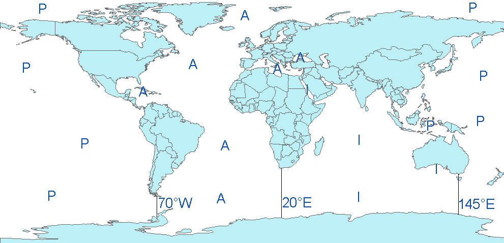
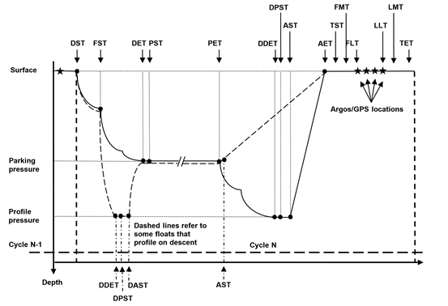

# Reference tables
The Argo reference tables are managed on Argo Vocabulary Server hosted on Nerc Vocabulary server (NVS). The Argo tables are prefixed with "R":

- [<u>https://vocab.nerc.ac.uk/collection</u>](https://vocab.nerc.ac.uk/collection)

## Reference table 1: data type
[<u>https://vocab.nerc.ac.uk/collection/R01/current</u>](https://vocab.nerc.ac.uk/collection/R01/current)

This table contains the list of acceptable values for the DATA_TYPE field.

## Reference table 2: Argo quality control flag scale
### Reference table 2: quality control flag scale
[<u>https://vocab.nerc.ac.uk/collection/RR2/current</u>](https://vocab.nerc.ac.uk/collection/RR2/current)  
[<u>https://vocab.nerc.ac.uk/collection/RD2/current</u>](https://vocab.nerc.ac.uk/collection/RD2/current)

A quality flag indicates the quality of an observation.

In addition to the NVS tables, the " " value is accepted (this is also observed as an empty space in NetCDF file). This case can occur, e.g., in aggregated {wmo}\_prof.nc and {wmo}\_Sprof.nc files when N_LEVELS (max of level number from single cycles) is not reached by a cycle, in synthetic single cycle files for levels not concerning a specific sensor, in BGC B\* files for sampling schemes not concerning a sensor, etc.

The flags are assigned in real-time or delayed mode according to the Argo quality control manual available at [<u>http://www.argodatamgt.org/Documentation</u>](http://www.argodatamgt.org/Documentation).

### Reference table 2a: overall profile quality flag
[<u>https://vocab.nerc.ac.uk/collection/RP2/current</u>](https://vocab.nerc.ac.uk/collection/RP2/current)

***N*** is defined as the percentage of levels with good data where:

- QC flag values of 1, 2, 5, 8 (only used in S-files) are GOOD data

- QC flag values of 0 (no QC), 9 (missing) or " " (FillValue) are NOT USED in the computation

- QC flag values of 3, 4 are BAD data

The computation should be taken from \<PARAM_ADJUSTED\>\_QC if available and from \<PARAM\>\_QC otherwise.

|       |                                                         |
|-------|---------------------------------------------------------|
| **n** | **Meaning**                                             |
| " "   | No QC is performed or no usable flag values are present |
| A     | ***N*** = 100%; All profile levels contain good data.   |
| B     | 75% \<= ***N*** \< 100%                                 |
| C     | 50% \<= ***N*** \< 75%                                  |
| D     | 25% \<= ***N*** \< 50%                                  |
| E     | 0% \< ***N*** \< 25%                                    |
| F     | ***N*** = 0%; No profile levels have good data.         |

Example: a TEMP profile has 60 levels (3 levels contain missing values).

- 45 levels are flagged as 1

- 5 levels are flagged as 2

- 7 levels are flagged as 4

- 3 levels are flagged as 9 (missing)

Percentage of good levels = ( (45 + 5) / 57) \* 100 = 87.7%

PROFILE_TEMP_QC = "B";

## Reference table 3: parameter code table 
[<u>https://vocab.nerc.ac.uk/collection/R03/current</u>](https://vocab.nerc.ac.uk/collection/R03/current)

Reference table 3 lists terms describing individual measured parameters or phenomena, used to mark up sets of data in Argo netCDF arrays. Argo netCDF variables PARAMETER, STATION_PARAMETERS, HISTORY_PARAMETER and TRAJECTORY_PARAMETERS are populated by [<u>R03</u>](https://vocab.nerc.ac.uk/collection/R03/current) altLabel.

[<u>R03</u>](https://vocab.nerc.ac.uk/collection/R03/current) altLabel is also used to name netCDF variables. These netCDF variables named after R03 altLabel are further described in the [<u>R03</u>](https://vocab.nerc.ac.uk/collection/R03/current) definition for their associated NetCDF local attributes and their variable properties. Here is an additional explanation:

- *category*: 'ib' stands for BGC intermediate parameter, 'ic' for core intermediate parameter, 'b' for BGC ocean state parameter, 'c' for core ocean state parameter;

- *fill_value*: NC_FILL_SHORT = -32767 and NC_FILL_DOUBLE = 9.969209968386869E36;

- *data_type*: 'short' is 16-bit integer, 'float' is a 32-bit IEEE floating point number, and 'double' is a 64-bit IEEE floating-point number;

- *extra_dim*: some parameters may have one additional dimension compared to the standard parameters dimensions (N_PROF, N_LEVELS) (e.g., [<u>§2.6.2</u>](#management-of-multi-dimensional-parameters)). When this is the case, an additional extra_dim attribute is present (currently, the only extra dimension is named N_VALUES\<x\> where \<x\> is the size of the additional dimension).

- *valid_min, valid_max* and *resolution*: these properties in the R03 refer to the parameterization used for the encoding into the GTS BUFR format, chosen to avoid loss of information whatever the sensor model. Within the GDAC NetCDF files, DACs are free to indicate specific values corresponding to the sensor model. The GTS BUFR format parameterization can be used as default values.

More details and comments are available in the associated Excel Spreadsheet [<u>https://github.com/OneArgo/argo-format-user-manual/blob/main/etc/r03-argo-parameters-list-core-and-b.xlsx</u>](https://github.com/OneArgo/argo-format-user-manual/blob/main/etc/r03-argo-parameters-list-core-and-b.xlsx).

The above link is also accessible from [<u>https://www.argodatamgt.org/Documentation.</u>](https://www.argodatamgt.org/Documentation)

If new parameters are required, they have to be added to this table before they can be accepted.  
To request for new parameter names, please either send an e-mail to the table responsible(s), who are mentioned in the [<u>readme of ArgoVocab Github</u>](https://github.com/OneArgo/ArgoVocabs?tab=readme-ov-file#VI-Management-special-case-for-R03-R14-and-R18-tables), or open a new AVFTT ticket ([<u>https://github.com/OneArgo/ArgoVocabs/issues</u>](https://github.com/OneArgo/ArgoVocabs/issues)).

### 3.3.1 Note on parameter local attributes in the NetCDF file
The *C_format*, *Fortran_format* and *resolution* local attributes are float/sensor dependents. They are set by the DAC (Data Assembly Centre). For each parameter, the ***resolution*** attribute is **mandatory**.

### How to indicate multiple sensors for the same parameter (multiple PARAMETER entries for the same parameter)
The PARAMETER field must be populated by unique entries. However, some floats are equipped with multiple sensors, measuring the same physical parameter(s). In that case, add the integer with an underscore "\_n" at the end of the code of the parameter.  
The integer "\_n" starts with "\_2" and increases by 1 when there are more than two sensors measuring the same physical parameter.

See [<u>§3.25.1</u>](#how-to-indicate-multiple-sensors-for-the-same-parameter-multiple-sensor-entries-for-the-same-parameter) for the corresponding rule regarding multiple SENSOR entries for the same parameter.

**Example**

If a float has one Optode and one SBE oxygen sensor:

- Use DOXY and TEMP_DOXY for Optode

- Use DOXY_2 for SBE

If a float has two Optode oxygen sensors:

- Use DOXY and TEMP_DOXY, and DOXY_2 and TEMP_DOXY_2

If a float has four SBE oxygen sensors:

- Use DOXY, DOXY_2, DOXY_3, DOXY_4

### Oxygen related parameters
Some Argo floats perform Oxygen observation from different types of sensors, such as the Aanderaa Optode or the Seabird SBE 43/IDO.

To provide homogeneous observations from heterogeneous sensors, oxygen measurement should be converted and reported as DOXY.

- DOXY is the dissolved oxygen concentration estimated from the telemetered, calibration coefficients and CTD values: PRES, TEMP (or TEMP_DOXY) and PSAL.  
  Pressure and salinity compensations (e.g. Optode) are taken into account.

- DOXY unit: micromole/kg

- DOXY_ADJUSTED is the dissolved oxygen concentration corrected for any sensor drift and offset. DOXY_ADJUSTED is calculated from the other "ADJUSTED" fields.

Calibration coefficients, equations and references used to convert the telemetered variables in DOXY must be carefully documented in the metadata.

The Argo oxygen data management is described at:

- [<u>http://www.argodatamgt.org/Documentation</u>](http://www.argodatamgt.org/Documentation), Cookbook documents, "Processing Argo oxygen data at the DAC level"

## Reference table 4: data centres and institutions codes
[<u>https://vocab.nerc.ac.uk/collection/R04/current</u>](https://vocab.nerc.ac.uk/collection/R04/current)

## Reference table 5: location classes
[<u>https://vocab.nerc.ac.uk/collection/R05/current</u>](https://vocab.nerc.ac.uk/collection/R05/current)

## Reference table 6: data state indicators
[<u>https://vocab.nerc.ac.uk/collection/R06/current</u>](https://vocab.nerc.ac.uk/collection/R06/current)

Data state indicator recommended use

The following table describes the processing stage of data and the value to be assigned the data state indicator (DS Indicator). It is the concatenation of level and class described above.

|                                                                                                                                                                                                                                                                                                                   |                  |
|-------------------------------------------------------------------------------------------------------------------------------------------------------------------------------------------------------------------------------------------------------------------------------------------------------------------|------------------|
| **Processing Stage**                                                                                                                                                                                                                                                                                              | **DS Indicator** |
| 1\. Data pass through a communications system and arrive at a processing centre. The data resolution is the highest permitted by the technical constraints of the floats and communications system.                                                                                                               | 0A (note 1)      |
| 2\. The national centre assembles all of the raw information into a complete profile located in space and time.                                                                                                                                                                                                   | 1A (note 2)      |
| 3\. The national centre passes the data through automated QC procedures and prepares the data for distribution on the GTS, to global servers and to PIs.                                                                                                                                                          | 2B               |
| 4\. Real-time data are received at global data centres that apply QC including visual inspection of the data. These are then distributed to users in near real-time                                                                                                                                               | 2B+ (note 3)     |
| 5\. Data are reviewed by PIs and returned to processing centres. The processing centres forward the data to the global Argo servers.                                                                                                                                                                              | 2C               |
| 6\. Scientists accept data from various sources, combine them as they see fit with other data and generate a product. Results of the scientific analysis may be returned to regional centres or global servers. Incorporation of these results improves the quality of the data.                                  | 2C+              |
| 7\. Scientists working as part of GODAE generate fields of gridded products delivered in near real-time for distribution from the global servers. Generally, these products mostly will be based on data having passed through automated QC procedures.                                                           | 3B (note 4)      |
| 8\. Scientists working as part of GODAE generate fields of gridded products delivered with some time delay for distribution from the global servers. Generally, these products mostly will be based on data having passed through manual or more sophisticated QC procedures than employed on the real-time data. | 3C               |

Notes

1.  We need to have a pragmatic approach to what constitutes "original" or "raw" data. Despite the fact that an instrument may be capable of high sampling rates, what is reported from the instrument defines what is considered "raw". For example, Argo floats can certainly sample at finer scales than every 10 db, but because of communications, all we see for now is data at that (or worse) vertical resolution. Therefore the data "coming from the instrument" is "raw" output at 10dbar resolution.

2.  The conversion of the raw data stream from the communications system into profiles of variables causes the data state indicator to switch from level 0 to 1.

3.  Even though the data at global data centres use manual or semi-automated QC procedures, there is often not the intercomparisons to larger data collections and fields that would qualify the data state indicator to be set to class C. This is generally only provided by scientific scrutiny of the data.

4.  The transition from class 2 to 3 occurs when assumptions of scales of variability are applied. During the course of normal data processing it is common to carry out some averaging and sub-sampling. This is usually done to exploit oversampling by the instrument, and to ensure good measurements are achieved. These are considered to be part of the geospatial and temporal referencing process.

5.  

## Reference table 7: history action codes
[<u>https://vocab.nerc.ac.uk/collection/R07/current</u>](https://vocab.nerc.ac.uk/collection/R07/current)

## Reference table 8: instrument types
[<u>https://vocab.nerc.ac.uk/collection/R08/current</u>](https://vocab.nerc.ac.uk/collection/R08/current)

The instrument type codes come from WMO table 1770. The R08 table is useful for the GTS-BUFR distribution of Argo data. Its revision depends on the WMO governance.

## Reference table 9: positioning system
[<u>https://vocab.nerc.ac.uk/collection/R09/current</u>](https://vocab.nerc.ac.uk/collection/R09/current)

## Reference table 10: transmission system
[<u>https://vocab.nerc.ac.uk/collection/R10/current</u>](https://vocab.nerc.ac.uk/collection/R10/current)

## Reference table 11: QC test binary IDs
[<u>https://vocab.nerc.ac.uk/collection/R11/current</u>](https://vocab.nerc.ac.uk/collection/R11/current)

This table is used to record the result of the quality control tests in the history section.

The binary IDs of the QC tests are used to define the history variable HISTORY_QCTEST, whose value is computed by adding the binary ID together, then translating to a hexadecimal number. An example is given on [<u>§5</u>](#using-the-history-section-of-the-argo-netcdf-structure).

The test numbers and the test names are listed Appendix 6.3 in the Argo Quality Control Manual for CTD and trajectory data [<u>https://archimer.ifremer.fr/doc/00228/33951/</u>](https://archimer.ifremer.fr/doc/00228/33951/).

## Reference table 12: history steps codes
[<u>https://vocab.nerc.ac.uk/collection/R12/current</u>](https://vocab.nerc.ac.uk/collection/R12/current)

If individual centres wish to record other codes, they may add to this list as they feel is appropriate.

## Reference table 13: ocean codes 
[<u>https://vocab.nerc.ac.uk/collection/R13/current</u>](https://vocab.nerc.ac.uk/collection/R13/current)

The ocean codes are used in the GDAC ftp directory files. The ocean code is not used in Argo NetCDF files.

- The Pacific/Atlantic boundary is 70°W.

- The Pacific/Indian boundary is 145°E.

- The Atlantic/Indian boundary is 20°E.

## Reference table 14: technical parameter names
[<u>https://vocab.nerc.ac.uk/collection/R14/current</u>](https://vocab.nerc.ac.uk/collection/R14/current)

Reference table 14 lists technical parameters reported by a float at every cycle. Technical parameter names are stored in the float 'tech.nc' file, under TECHNICAL_PARAMETER_NAME. Each technical parameter name has an associated value, stored in TECHNICAL_PARAMETER_VALUE.

Argo netCDF variable TECHNICAL_PARAMETER_NAME is populated by [<u>R14</u>](https://vocab.nerc.ac.uk/collection/R14/current) prefLabel. When [<u>R14</u>](https://vocab.nerc.ac.uk/collection/R14/current) prefLabel contains a template indicated between \< and \>, the accepted values replacing this template are listed in the [<u>R14</u>](https://vocab.nerc.ac.uk/collection/R14/current) entry definition. Additionally, the last part of prefLabel (separated by underscores) contains the main extension, generally the unit, of the parameter. The other extensions or units that are accepted are also listed in the NVS entry definition.

More details and comments are available in the associated Excel Spreadsheet available at [<u>https://github.com/OneArgo/argo-format-user-manual/blob/main/etc/r14-ArgoTechnicalParameterNames.xlsx</u>](https://github.com/OneArgo/argo-format-user-manual/blob/main/etc/r14-ArgoTechnicalParameterNames.xlsx)

All technical parameter names are standardized. The naming convention for technical parameters is available at [<u>https://github.com/OneArgo/argo-format-user-manual/blob/main/etc/Technical_Naming_Convention_rules_V4.doc</u>](https://github.com/OneArgo/argo-format-user-manual/blob/main/etc/Technical_Naming_Convention_rules_V4.doc).

The full list of possible units is available at [<u>https://github.com/OneArgo/argo-format-user-manual/blob/main/etc/Table%20Tech%20and%20Conf%20Units.xlsx</u>](https://github.com/OneArgo/argo-format-user-manual/blob/main/etc/Table%20Tech%20and%20Conf%20Units.xlsx).

The above links are also accessible from [<u>https://www.argodatamgt.org/Documentation.</u>](https://www.argodatamgt.org/Documentation)

If new names are required as new variables are reported by a float, they must be added to this table before they can be accepted. To request for new technical parameter names, please either send an e-mail to the table responsible(s), who are mentioned in the [<u>readme of ArgoVocab Github</u>](https://github.com/OneArgo/ArgoVocabs?tab=readme-ov-file#VI-Management-special-case-for-R03-R14-and-R18-tables), or open a new ticket [<u>here : https://github.com/OneArgo/ArgoVocabs/issues</u>](https://github.com/OneArgo/ArgoVocabs/issues).

Older style files will be accepted for a short time and then all technical files must use approved names for standardized variables

## Reference table 15: codes of trajectory measurements performed within a cycle
All possible measurement codes, including primary, secondary, relative generic and relative specific codes are detailed in [<u>https://vocab.nerc.ac.uk/collection/R15/current</u>](https://vocab.nerc.ac.uk/collection/R15/current). The categories (primary, secondary, etc.) are listed in [<u>https://vocab.nerc.ac.uk/collection/RMC/</u>](https://vocab.nerc.ac.uk/collection/RMC/) and R15 entries are associated with a category in RMC.

Figure 1: Figure showing float cycle and the cycle timing variables. Floats can profile either on descent or ascent. Most floats profile on ascent. Their float path is shown with a solid black line. Some floats profile on descent. One such float, the new SOLO-II Deep float, has a cycle as shown by the dashed line.

Floats that profile on ascent would have the following mandatory cycle timings:

- DST, DET, PET, DDET, AST, AET and all surface times

Floats that profile on descent might have the following cycle timings:

- DST, DDET, DAST, DET, PET, AST, AET, and all surface times

Cycle timings are more thoroughly explained within the Argo Trajectory cookbook ([<u>https://dx.doi.org/10.13155/29824</u>](https://dx.doi.org/10.13155/29824)).

General Measurement Code Table Key

<table>
<colgroup>
<col style="width: 33%" />
<col style="width: 66%" />
</colgroup>
<tbody>
<tr class="odd">
<td><strong>Measurement code type</strong></td>
<td><strong>Definition</strong></td>
</tr>
<tr class="even">
<td>Any code evenly divisible by 100 (e.g. 100, 200, 300, etc.)</td>
<td><strong>Primary Measurement Codes (MC).</strong> Each marks a mandatory-to-fill cycle timing variable. These are very important for determining trajectory estimates. All are found in both the N_MEASUREMENT and N_CYCLE data arrays.</td>
</tr>
<tr class="odd">
<td>Any code evenly divisible by 50 but not evenly divisible by 100 (e.g. 150, 250, 450, et)</td>
<td><strong>Secondary Measurement Codes (MC).</strong> Each marks a suggested-to-fill cycle timing variable. Secondary MC are not always applicable to all floats, but are very useful in determining trajectory estimates.</td>
</tr>
<tr class="even">
<td>
Any code that falls in between any Primary or Secondary Measurement Code (span of 50 values). These codes describe data that are important cycle timing information but are not as important as the primary or secondary timing variables.

The value span is subdivided into two halves. Measurement codes in this section will be described relative to the values of the Primary and Secondary codes.
</td>
<td>
<strong>Relative Generic Codes.</strong> Values spanning from MC minus 25 to MC minus 1: Measurement codes that have lower value and within 25 of a Primary or Secondary Measurement Code. These code definitions are phrased generally, so can be attached to data from many different floats. These code values (MC minus 25 to MC minus 1) are assigned when a float records a measurement while transitioning TOWARDS the MC. The definitions of the MC from MC minus 25 to MC minus 1 are repeated for all Primary and Secondary MC. An example, most floats record pressure/temperature/salinity during drift. The float is transitioning towards PET (MC=300) during this period. Thus the pressure/temperature/salinity measurements will have an MC between MC minus 25 and MC minus 1 where MC=300 (thus between MC=276 and MC=299). Which value is chosen is determined by the measurement itself (See table below).

<strong>Relative Specific Codes.</strong> Values spanning from MC plus 1 to MC plus 25: These are specific measurements that are generally NOT recorded by multiple float types. They are believed to be valuable enough in trajectory estimation that they are defined here, and not within the generically defined MC minus 25 to MC minus 1 span. MC codes in this span will be specific to the MC code, and will NOT be repeated for other Primary and Secondary MCs. An example, APEX floats report the "Down-time end date", which is important in determining the start of ascent (MC=500). The MC for "Down-time end date" is recorded with MC plus 1 (MC=501).
</td>
</tr>
</tbody>
</table>

Relative Generic Code Table Key (from MC minus 25 to MC minus 1)

Relative Generic codes refer to any measurement code that has a smaller value within 25of a Primary or Secondary Measurement Code. Their definition applies relatively to every Primary and Secondary code (see table below).

For example, AST (time of ascent start, MC=500) and AET (time of ascent end, MC=600) are both Primary MCs. There exists a measurement code MC minus 4 for both AST and AET which is assigned to any averaged measurement that is taken while transitioning towards the MC. If an averaged measurement is recorded while transitioning towards AST, the correct MC=496. If an averaged measurement is recorded while transitioning towards AET, the correct MC=596.

|                                 |                                                                                                                                                                                                      |
|---------------------------------|------------------------------------------------------------------------------------------------------------------------------------------------------------------------------------------------------|
| Relative Measurement code       | Meaning                                                                                                                                                                                              |
| MC minus 1                      | Any single measurement transitioning towards MC (see MC-10 for a 'series' of measurements)                                                                                                           |
| MC minus 2                      | Maximum value while float is transitioning towards an MC (e.g. pressure)                                                                                                                             |
| MC minus 3                      | Minimum value while float is transitioning towards an MC (e.g. pressure)                                                                                                                             |
| MC minus 4                      | Any averaged measurements made during transition to MC                                                                                                                                               |
| MC minus 5                      | Median value while float is transitioning towards an MC                                                                                                                                              |
| MC minus 6                      | Standard deviation of measurements taken during transition towards an MC                                                                                                                             |
| MC minus 7 to MC minus 9        | currently unassigned                                                                                                                                                                                 |
| MC minus 10                     | Any "series" of measurements recorded while transitioning towards MC. (e.g. Provor 'spy' measurements, SOLOII pressure-time pairs, etc).                                                             |
| MC minus 11                     | Active adjustment to buoyancy made at this time                                                                                                                                                      |
| MC minus 12                     | Any supporting measurements for the maximum value (MC minus 2)                                                                                                                                       |
| MC minus 13                     | Any supporting measurements for the minimum value (MC minus 3)                                                                                                                                       |
| MC minus 14                     | Any supporting measurements for the average value (MC minus 4)                                                                                                                                       |
| MC minus 15                     | Any supporting measurements for the median value (MC minus 5)                                                                                                                                        |
| MC minus 16 to MC minus 24      | currently unassigned                                                                                                                                                                                 |
| MC minus 25                     | Any estimated RAFOS positions and times                                                                                                                                                              |
| MC 100, 600, 700 or 800 plus 10 | Any in-water samples taken as part of a surface sequence. (e.g. O2 samples taken prior to air-bladder inflation, after air-bladder deflation or max buoyancy as part of in-air measurement sequence) |
| MC 100, 600, 700 or 800 plus 11 | Any in-air samples taken as part of a surface sequence. (e.g. O2 samples taken after air-bladder inflation, prior to air-bladder deflation, or max buoyancy as part of in-air measurement sequence)  |

## Reference table 16: vertical sampling schemes
[<u>https://vocab.nerc.ac.uk/collection/R16/current</u>](https://vocab.nerc.ac.uk/collection/R16/current)

This variable differentiates the various vertical sampling schemes for multiple profiles from a single cycle. This variable can vary between cycles to accommodate floats with two-way communication capabilities. The profile with N_PROF=1 is required to be the Primary sampling profile. Other profiles will have N_PROF \> 1 in any order. There can be only one Primary sampling profile, while other vertical sampling schemes can have more than one profile.

<table>
<colgroup>
<col style="width: 32%" />
<col style="width: 10%" />
<col style="width: 56%" />
</colgroup>
<tbody>
<tr class="odd">
<td>
<strong>Code (STRING256)</strong>

<strong>FORMAT → name: nominal measurement type [full description]</strong>

<strong>[ ] indicates optional</strong>
</td>
<td><strong>N_PROF</strong></td>
<td><strong>Code Description</strong></td>
</tr>
<tr class="even">
<td>
Primary sampling: averaged [description]

or 
Primary sampling: discrete [description]

or

Primary sampling: mixed [description]
</td>
<td>1</td>
<td>Primary CTD measurements and measurements from auxiliary sensors that are taken at the same pressure levels and with the same sampling method as the Primary CTD profile. For auxiliary sensor measurements it is not required that all pressure levels contain data.</td>
</tr>
<tr class="odd">
<td>
Secondary sampling: averaged [description]

or

Secondary sampling: discrete [description]

or

Secondary sampling: mixed [description]
</td>
<td>&gt;1</td>
<td>Excluding "Primary sampling", this profile includes measurements that are taken at pressure levels different from the Primary CTD profile, or with sampling methods different from the Primary CTD profile. Measurements can be taken by the Primary CTD or by auxiliary sensors.</td>
</tr>
<tr class="even">
<td>
Near-surface sampling: averaged,

pumped/unpumped [description]

or

Near-surface sampling: discrete,

pumped/unpumped [description]

or

Near-surface sampling: mixed,

pumped/unpumped [description]
</td>
<td>&gt;1</td>
<td>This profile includes near-surface measurements that are focused on the top 5dbar of the sea surface. (For the purpose of cross-calibration, this profile can extend deeper than the top 5dbar so as to overlap with the Primary sampling profile.) These measurements are taken at pressure levels different from the Primary CTD profile, or with sampling methods different from the Primary CTD profile. If the Primary sampling profile measures above 5dbar in the same manner as deeper data, there is no need to place the near-surface data here.</td>
</tr>
<tr class="odd">
<td>
Bounce sampling: averaged [description]

or

Bounce sampling: discrete [description]

or

Bounce sampling: mixed [description]
</td>
<td>&gt;1</td>
<td>This scheme contains profiles that are collected on multiple rises/falls during a single cycle. The profiles are temporally offset from each other and/or the Primary sampling profile. They can be sampled with the Primary CTD or with auxiliary sensors.</td>
</tr>
<tr class="even">
<td colspan="3">Use the term 'averaged' if the data in the profile are pressure binned averages using multiple data measurements (pollings) from a sensor. Use the term 'discrete' if the data in the profile are from a single polling from a sensor. If both methods are used in the profile, use the term 'mixed'.</td>
</tr>
</tbody>
</table>

Example for a SOLOII V1.2 float

N_PROF=1: "Primary sampling: averaged \[nominal 2 dbar binned data sampled at 0.5 Hz from a SBE41CP\]"

N_PROF=2: "Near-surface sampling: discrete, pumped \[shallowest polling of a SBE41CP\]"

Note: In this example, by adding a single data point in N_PROF=2, the size of the profile file will double.

Example for a Provor bio 5.0 float

This float is equipped with a Seabird CTD and a Wetlab Satrover optical sensor.

CTD sampling scheme:

- The threshold between deep sampling and upper sampling is 200 decibars.

- Upper sampling: 10 decibars slice thickness, 10 seconds sampling rate.

- Deep sampling: 25 decibars slice thickness, 10 seconds sampling rate.

Chlorophyll (optical) sampling scheme:

- The threshold between deep sampling and upper sampling is 300 decibars.

- Upper sampling: 1 decibar slice thickness, 1 seconds sampling rate.

- Deep sampling: 10 decibars slice thickness, 10 seconds sampling rate.

- Deepest sampling: 1000 decibars.

Description of the 2 vertical sampling schemes:

N_PROF=1: "Primary sampling: averaged \[10 seconds sampling, 25 decibars average from bottom to 200 decibars, 10 seconds sampling, 10 decibars average from 200 decibars to surface\]"

N_PROF=2: "Secondary sampling: averaged \[10 seconds sampling, 10 decibars average from 1000 decibars to 300 decibars, 1 second sampling, 1 decibar average from 300 decibars to surface\]"

Example for an APEX Iridium float with an Optode oxygen sensor and an auxiliary CTD for near-surface measurements

N_PROF=1: "Primary sampling: averaged \[2-dbar bin average\]"

N_PROF=2: "Secondary sampling: discrete \[1.1 Hz CTD data, discrete DOXY\]"

N_PROF=3: "Near-surface sampling: discrete, unpumped \[auxiliary CTD\]"

## Reference table 17: obsolete
This table has been removed.

## Reference table 18: metadata configuration parameter names
[<u>https://vocab.nerc.ac.uk/collection/R18/current</u>](https://vocab.nerc.ac.uk/collection/R18/current)

Reference table 18 lists configuration settings selected by the float Principal Investigator (PI). Configuration parameters may or may not be reported by the float, and do not constitute float measurements.

Configuration parameters selected for a float are stored in the float 'meta.nc' file, under CONFIG_PARAMETER_NAME and LAUNCH_CONFIG_PARAMETER_NAME.

Each configuration parameter name has an associated value, stored in CONFIG_PARAMETER_VALUE and LAUNCH_CONFIG_PARAMETER_VALUE.

Argo netCDF variables CONFIG_PARAMETER_NAME and LAUNCH_CONFIG_PARAMETER_NAME are populated by [<u>R18</u>](https://vocab.nerc.ac.uk/collection/R18/current) prefLabel. When [<u>R18</u>](https://vocab.nerc.ac.uk/collection/R18/current) prefLabel contains a template indicated between ‘\<’ and ‘\>’, the accepted values replacing this template are listed in the concept definition. Additionally, the last part of prefLabel (separated by underscores) contains the main extension, generally the unit, of the parameter. The other extensions or units that are accepted are also listed in the concept definition.

More details and comments are available in the associated Excel Spreadsheets (R18 core and R18 bgc):

- [<u>https://github.com/OneArgo/argo-format-user-manual/blob/main/etc/r18-Core_Argo_ConfigurationParameterNames.xlsx</u>](https://github.com/OneArgo/argo-format-user-manual/blob/main/etc/r18-Core_Argo_ConfigurationParameterNames.xlsx)

- 

<u>https://github.com/OneArgo/argo-format-user-manual/blob/main/etc/r18-Bio_Argo_Configuration_Parameter_Names.xlsx</u>The full list of possible units is available at [<u>https://github.com/OneArgo/argo-format-user-manual/blob/main/etc/Table%20Tech%20and%20Conf%20Units.xlsx</u>](https://github.com/OneArgo/argo-format-user-manual/blob/main/etc/Table%20Tech%20and%20Conf%20Units.xlsx).

The above links are also accessible from [<u>https://www.argodatamgt.org/Documentation.</u>](https://www.argodatamgt.org/Documentation)

If new names are required as new variables are reported by a float, they must be added to this table before they can be accepted. To request for new configuration parameter names, please either send an e-mail to the table responsible(s), who are mentioned in the [<u>readme of ArgoVocab Github</u>](https://github.com/OneArgo/ArgoVocabs?tab=readme-ov-file#VI-Management-special-case-for-R03-R14-and-R18-tables), or open a new ticket [<u>here : https://github.com/OneArgo/ArgoVocabs/issues</u>](https://github.com/OneArgo/ArgoVocabs/issues).

Please note that in this scheme, configuration parameter values are stored as numerals and therefore any parameters with logical or string input will require an equivalent numeric code that must be explained in the parameter [<u>R18</u>](https://vocab.nerc.ac.uk/collection/R18/current) definition. Here are a few examples of how to write : (1 = averaged, 0 = spot sampling), (0 = No, 1=Yes), (0: nominal speed and 5: lowest speed).

## Reference table 19: STATUS flags
[<u>https://vocab.nerc.ac.uk/collection/R19/current</u>](https://vocab.nerc.ac.uk/collection/R19/current)

## Reference table 20: GROUNDED flags
[<u>https://vocab.nerc.ac.uk/collection/R20/current</u>](https://vocab.nerc.ac.uk/collection/R20/current)

## Reference table 21: REPRESENTATIVE_PARK_PRESSURE_STATUS
[<u>https://vocab.nerc.ac.uk/collection/R21/current</u>](https://vocab.nerc.ac.uk/collection/R21/current)

## Reference table 22: PLATFORM_FAMILY
[<u>https://vocab.nerc.ac.uk/collection/R22/current</u>](https://vocab.nerc.ac.uk/collection/R22/current)

Please note that this reference table is frequently updated to include new sensor and float models.

## Reference table 23: PLATFORM_TYPE
[<u>https://vocab.nerc.ac.uk/collection/R23/current</u>](https://vocab.nerc.ac.uk/collection/R23/current)

Please note that this reference table is frequently updated to include new sensor and float models.

## Reference table 24: PLATFORM_MAKER
[<u>https://vocab.nerc.ac.uk/collection/R24/current</u>](https://vocab.nerc.ac.uk/collection/R24/current)

Please note that this reference table is frequently updated to include new sensor and float models.

##  Reference table 25: SENSOR
[<u>https://vocab.nerc.ac.uk/collection/R25/current</u>](https://vocab.nerc.ac.uk/collection/R25/current)

Please note that this reference table is frequently updated to include new sensor and float models.

###  How to indicate multiple sensors for the same parameter (multiple SENSOR entries for the same parameter)
The SENSOR field must be populated by unique entries. However, some floats are equipped with multiple sensors of the same kind (i.e. same SENSOR name) that measure the same physical parameter(s). In that case, add the integer with an underscore "\_n" at the end of the code of the sensor.  
The integer "\_n" starts with "\_2" and increases by 1 when there are more than two sensors measuring the same physical parameter.

This is to ensure that the PARAMETER_SENSOR field can be unambiguously used to match fields for which the dimension is N_PARAMETER to fields for which the dimension is N_SENSOR.

See [<u>§3.3.1</u>](#note-on-parameter-local-attributes-in-the-netcdf-file) for the corresponding rule regarding the PARAMETER field.

Examples:

If a float has two pressure sensors (for instance a KELLER and a QUARTZDYNE):

- Fill in SENSOR for the KELLER as being CTD_PRES

- Fill in SENSOR for the QUARTZDYNE as being CTD_PRES_2

If a float has two different sensors measuring the same parameter, there is no need to add the "\_2". For instance if DOXY is measured by both SENSOR = OPTODE_DOXY and SENSOR= IDO_DOXY, as the uniqueness is ensured, there is no need for an additional "\_2".

## Reference table 26: SENSOR_MAKER
[<u>https://vocab.nerc.ac.uk/collection/R26/current</u>](https://vocab.nerc.ac.uk/collection/R26/current)

Please note that this reference table is frequently updated to include new sensor and float models.

Please note that the sensor_maker table also includes a subset of platform_maker entries, for those floats which report MTIME from the inner clock of the platform.

## Reference table 27: SENSOR_MODEL
[<u>https://vocab.nerc.ac.uk/collection/R27/current</u>](https://vocab.nerc.ac.uk/collection/R27/current)

The SENSOR_MODEL variable is standardised, i.e. we expect the manufacturer followed by the standard model number, i.e. SBE41CP or AANDERAA_3830. If there is a version number for a particular model then this is mentioned in the SENSOR_FIRMWARE_VERSION field.

**\*** Note that some biogeochemical sensors have different configurations, i.e. they are either in the pumped stream or not in the pumped stream. Sensor readings from those in the pumped vs unpumped stream can be very different. Some manufacturers do not distinguish this in the sensor model name. In order to capture this information there is a configuration parameter that specifies this, i.e. CONFIG_SensorInPumpedStream_LOGICAL, (Yes =1, No = 0). For the relevant sensors this configuration parameter should be filled in the metadata file for the launch configuration settings.

## Reference table 28: CONTROLLER_BOARD_TYPE_PRIMARY
[<u>https://vocab.nerc.ac.uk/collection/R28/current</u>](https://vocab.nerc.ac.uk/collection/R28/current)

The first part of the CONTROLLER_BOARD_TYPE_PRIMARY variable should contain one of the strings in the below table. The remainder of the string is free text and may contain more information on the controller board type to suit the float model. The free text should be delimited by square brackets ‘\[\]’. For example: "APF9 \[iridium version xyz\]". Please note that this reference table is sometimes updated to include new sensor and float models.

## Reference table 31: ENDING_CAUSE 
[<u>https://vocab.nerc.ac.uk/collection/R31/current</u>](https://vocab.nerc.ac.uk/collection/R31/current)

This vocabulary captures all the possible reasons why a float may have died.

The "ending cause" for a float is stored in the "ANOMALY" variable of its meta-data file. They are reported with a "key0:value0\[,value1\]" syntax where key0 = "ending_cause" and value0,value1, etc. belong to the [<u>R31</u>](https://vocab.nerc.ac.uk/collection/R31/current) table.

The "ANOMALY" variable describes any anomalies or problems the float may have had. Anomalies or problems are semi-colon separated statements.

**Example:**

ANOMALY = "ASD:AbruptSaltyDrift;ending_cause:battery_end_of,stuck_on_surface,beached;cmt:Argo float recovered in norther Spain"

## Reference table 33: BATTERY MAKER
List of battery manufacturers, used in value convention within BATTERY_TYPE variable.

[<u>https://vocab.nerc.ac.uk/collection/R33/</u>](https://vocab.nerc.ac.uk/collection/R33/)

## Reference table 34: BATTERY TYPE
List of battery type, used in value convention within BATTERY_TYPE and BATTERY_PACKS variables.

[<u>https://vocab.nerc.ac.uk/collection/R34/</u>](https://vocab.nerc.ac.uk/collection/R34/)

## Reference table 35: BATTERY SIZE
List of battery size, used in value convention within the BATTERY_PACKS variable.

[<u>https://vocab.nerc.ac.uk/collection/R35/</u>](https://vocab.nerc.ac.uk/collection/R35/)

## Reference table 40 : PI_NAME
[<u>https://vocab.nerc.ac.uk/collection/R40</u>](https://vocab.nerc.ac.uk/collection/R40/)

This table captures the possible PI_NAME. The preferred label is composed in most cases by the first name in lower cases and the family name in upper cases. When there are several Principal Investigators, their names should be separated by commas.

## Reference table 41 : PROGRAM_NAME
[<u>https://vocab.nerc.ac.uk/collection/R41</u>](https://vocab.nerc.ac.uk/collection/R41)

This table captures the possible entries for the PROGRAM_NAME variable.

## Reference table 42 : ICE_ALGORITHM_STATUS
This table captures the possible entries for the **ICE_ALGORITHM_STATUS** variable.

The reference table 42 will soon become available on the NVS using the following link

[<u>https://vocab.nerc.ac.uk/collection/R42</u>](https://vocab.nerc.ac.uk/collection/R42)

In the meanwhile, the table here-below can be used:

<table>
<colgroup>
<col style="width: 22%" />
<col style="width: 77%" />
</colgroup>
<tbody>
<tr class="odd">
<td><blockquote>

<strong>ICE_ALGORITHM_STATUS value</strong>

</blockquote></td>
<td><blockquote>

<strong>Definition</strong>

</blockquote></td>
</tr>
<tr class="even">
<td><blockquote>

-1

</blockquote></td>
<td><blockquote>

Ice algorithm disabled in this cycle. Basic scheme.

</blockquote></td>
</tr>
<tr class="odd">
<td><blockquote>

99999 (FillValue)

</blockquote></td>
<td><blockquote>

Ice algorithm status is not transmitted by the float either by design, or the data was not received. Basic scheme.

</blockquote></td>
</tr>
<tr class="even">
<td><blockquote>

0

</blockquote></td>
<td><blockquote>

Ice algorithm enabled in this cycle and returned a negative status (chose to continue towards the surface for any reason). Basic scheme.

</blockquote></td>
</tr>
<tr class="odd">
<td><blockquote>

1

</blockquote></td>
<td><blockquote>

Ice algorithm enabled in this cycle and returned a positive status (chose NOT to continue towards the surface for any reason). Basic scheme.

</blockquote></td>
</tr>
<tr class="even">
<td><blockquote>

-2

</blockquote></td>
<td><blockquote>

Ice algorithm is disabled, yet the float indicated it was unable to telemeter and/or reached a timeout at the surface, satellite (sat) mask, or ascent hanging. Extended scheme (maps to -1 in basic scheme).

</blockquote></td>
</tr>
<tr class="odd">
<td><blockquote>

100

</blockquote></td>
<td><blockquote>

Irrespective of other tests (e.g. ISA), the ice algorithm forced ascent to the surface in this cycle. This could be programmed as after a set date or number of cycles (or other). Without additional information, this is the standard value when ‘forced ascent’ to the surface occurs. If additional information is known, a value of 10 may be more appropriate. Extended scheme (maps to 0 in basic scheme).

</blockquote></td>
</tr>
<tr class="even">
<td><blockquote>

2

</blockquote></td>
<td><blockquote>

Ice algorithm enabled and returned positive with a mixed-layer temperature check. Extended scheme (maps to 1 in basic scheme).

</blockquote></td>
</tr>
<tr class="odd">
<td><blockquote>

3

</blockquote></td>
<td><blockquote>

Ice algorithm enabled and returned Ice Breakup = true. The mixed-layer temperature check (or other test) was negative; however, the float will not surface for a number of cycles/given duration after the last positive mixed-layer temperature check as a safety-delay (see float specific manuals for details, e.g., Ice Breakup for some floats). Extended scheme (maps to 1 in basic scheme).

</blockquote></td>
</tr>
<tr class="even">
<td><blockquote>

4

</blockquote></td>
<td><blockquote>

Ice algorithm enabled and 'ice cap' positive detection returned (e.g. known on APEX, perhaps others). Three conditions must be met, failure of telemetry, ascent timeout reached and water temp &lt; critical temp. Extended scheme (maps to 1 in basic scheme).

</blockquote></td>
</tr>
<tr class="odd">
<td><blockquote>

5

</blockquote></td>
<td><blockquote>

Ice algorithm enabled and satellite mask was positive (e.g. known on Arvor, perhaps others), i.e., failure to connect to satellites or communication timeout. Extended scheme (maps to 1 in basic scheme).

</blockquote></td>
</tr>
<tr class="even">
<td><blockquote>

6

</blockquote></td>
<td><blockquote>

Ice algorithm enabled and ISA and satellite mask were both positive (e.g. known on Arvor, perhaps others), i.e., thermal check plus a failure to connect to satellites or communication timeout. Extended scheme (maps to 1 in basic scheme).

</blockquote></td>
</tr>
<tr class="odd">
<td><blockquote>

7

</blockquote></td>
<td><blockquote>

Ice algorithm enabled and 'ascent hanging' or ‘collision detection’ returned positive (e.g. known on Arvor, perhaps others, see float manuals). Extended scheme (maps to 1 in basic scheme).

</blockquote></td>
</tr>
<tr class="even">
<td><blockquote>

8

</blockquote></td>
<td><blockquote>

Ice algorithm enabled but a positive ascent hanging or collision detection occurred either before ISA or Breakup period, or in conjunction with the ISA or Breakup period returning negative. Extended scheme (maps to 1 in basic scheme).

</blockquote></td>
</tr>
<tr class="odd">
<td><blockquote>

9

</blockquote></td>
<td><blockquote>

Ice algorithm enabled and 'ice cap' and/or ‘thermal’ check returned negative, but float reached a timeout period without telemetering (Surface Uptime Timeout). This might happen when the float is stuck on the sea floor, or beneath sea ice or an ice shelf (e.g., known on APEX, perhaps others). Extended scheme (maps to 1 in basic scheme).

</blockquote></td>
</tr>
<tr class="even">
<td><blockquote>

10

</blockquote></td>
<td><blockquote>

Irrespective of other tests (e.g., ISA), the ice algorithm forced ascent to the surface in this cycle. This could be programmed within the float as following a set date or number of cycles (or other). Additionally, the ice-algorithm indicated either a failure to telemeter, sat mask or pressure hanging before the surface time-out was reached. This might indicate the float is stuck beneath ice. Extended scheme (maps to 1 in basic scheme).

</blockquote></td>
</tr>
<tr class="odd">
<td><blockquote>

11

</blockquote></td>
<td><blockquote>

Ice algorithm enabled and stopped ascent to surface due to a check of salinity (e.g. known on ALTO, perhaps others). Extended scheme (maps to 1 in basic scheme).

</blockquote></td>
</tr>
</tbody>
</table>

